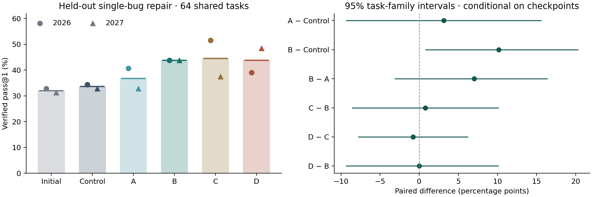

# Self-play and self-distillation for coding agents

Can a coding agent learn to repair programs by practicing on bugs it creates?
We study how two choices affect this process: the **student's learning
objective** and the **proposer's reward** for creating repair tasks. Our
student edits Python programs, runs public tests, and receives a binary reward
from an isolated verifier. The proposer and student share a LoRA adapter.

## Related work

- **Absolute Zero** uses a proposer and solver with executable feedback to
  generate a self-play curriculum. We adapt this idea to bugs introduced into
  existing programs and use a difficulty-based proposer as our control.
  [Absolute Zero](https://arxiv.org/abs/2505.03335)
- **CompassPlay** rewards proposed tasks according to how their student
  gradients align with a target direction. Our C and D experiments compare
  two candidate gradients against the same reference-repair direction.
  [CompassPlay](https://arxiv.org/abs/2609.32228)
- **On-policy self-distillation (OPSD)** scores student-generated tokens
  using a teacher given privileged information. **SDAR** adds a sigmoid gate
  to that feedback. We test ungated and gated OPSD using the correct repair as
  privileged teacher context. [OPSD](https://arxiv.org/abs/2601.18734) ·
  [SDAR](https://arxiv.org/abs/2605.15155)

These are influences on our experiments. The results below are from our own
adapted repair setting.

## Experimental setting

| Component | Setting |
| --- | --- |
| Model | Qwen3.5-4B with a shared proposer/student FP32 LoRA adapter, rank 32 |
| Training data | Adapted [Precise Debugging Benchmark](https://arxiv.org/abs/2604.17338) (PDB). The shared proposer generates bugs from **12 training parent programs**. The frozen bundle also contains 12 solver-training tasks for a separate fixed-curriculum pilot. |
| Training budget | **512 attempted student episodes per method per seed**, four student rollouts per generated task, seeds 2026 and 2027. This produced 19–22 optimizer steps. |
| Validation | **24 fixed development tasks**, evaluated at 0, 64, 128, 256, 384, and 512 episodes. This set was inspected repeatedly. |
| Primary evaluation | **64 held-out single-bug repair tasks**, the same tasks for each method and seed. Success means passing the final verifier. |
| Transfer evaluation | Original sets contain 8 PDB-Multi tasks, 1 PDB cross-source task, and 9 BigCodeBench-derived mutants. An additional independent evaluation contains **17 BigCodeBench-derived single-bug** and **32 LiveCodeBench-derived two-bug** tasks. |
| Original inference budget | Eight turns, 4,096 generated tokens per turn, and 12,288 per episode. |

The teacher sees the correct repair during training. The student does not
receive that privileged context during evaluation. The generated training
tasks vary across methods, so equal episode counts do not imply identical data
or compute.

| Method | Student objective | Proposer reward | Comparison it helps test |
| --- | --- | --- | --- |
| **Initial** | Initial model, without self-play training | — | Starting repair performance |
| **Control** | Verifier-driven Dr. GRPO | Difficulty, favoring tasks with mixed success | Baseline for the trained methods |
| **A** | Dr. GRPO + ungated OPSD | Difficulty | A vs Control tests adding ungated distillation |
| **B** | Dr. GRPO + gated OPSD | Difficulty | B vs A tests gating; B vs Control tests gated distillation against RL |
| **C** | Dr. GRPO + gated OPSD | Alignment of the student's **RL gradient** with a reference-repair gradient | C vs B tests gradient-aligned rather than difficulty-based proposals |
| **D** | Dr. GRPO + gated OPSD | Alignment of the **RL + gated OPSD gradient** with the same reference direction | D vs C tests including distillation in the proposer signal |

## Primary results

| Method | Seed 2026 | Seed 2027 | Mean pass@1 | Seed SD |
| --- | ---: | ---: | ---: | ---: |
| Initial | 21/64 | 20/64 | 32.03% | 1.10 pp |
| Control | 22/64 | 21/64 | 33.59% | 1.10 pp |
| A | 26/64 | 21/64 | 36.72% | 5.52 pp |
| B | 28/64 | 28/64 | 43.75% | 0.00 pp |
| C | 33/64 | 24/64 | 44.53% | 9.94 pp |
| D | 25/64 | 31/64 | 43.75% | 6.63 pp |

SD is the **sample standard deviation across two training seeds**, in
percentage points (pp). The same 64 tasks were reused across seeds. An SD of
zero for B reflects two equal observed scores and does not establish
stability across training runs.

At the original budget, B exceeded Control by **10.16 pp** and A by **7.03 pp**
on average. A paired task-family bootstrap gives B minus Control
**+10.16 pp [0.78, 20.31]** and B minus A **+7.03 pp [−3.13, 16.41]**.
These intervals describe task variation conditional on the two trained
checkpoints. They do not measure uncertainty across training seeds.

C and D reversed order across seeds. C exceeded D by 8 repairs in 2026,
while D exceeded C by 7 in 2027. Their mean difference is too small and
seed-dependent to identify a reliable proposer-reward winner.

## What else did we learn?

**Gating changes both direction and strength.** A and B use the same
nominal OPSD coefficient, but B's median weighted distillation-to-RL gradient
norm was substantially smaller: 0.177 vs 0.674 in 2026 and 0.214 vs 0.758
in 2027. The current comparison cannot isolate selective gating from weaker
distillation.

**D produces a denser proposer signal.** On identical candidate tasks,
rollouts, and model snapshots, C's candidate gradient was near zero on
264/512 records and D's on 0/512. This shows a change in gradient availability
on the observed tasks. It does not establish an accuracy benefit.
[Gradient analysis](docs/figures/task23/06-alignment.pdf)

**The inference budget affects the ranking.** Increasing the per-turn cap
from 4,096 to 6,144 tokens, while keeping the other episode limits fixed,
left total repairs at 300/768 across all checkpoint-task outcomes. B's mean
advantage over Control narrowed from +10.16 to +0.78 pp. The agent also sees
the changed budget in its prompt.
[Budget comparison](docs/figures/task23/08-failure-and-budget.pdf)

**Transfer results depend on the task shift.** On the 17 new cross-source
tasks, B averaged 79.41% and Control 73.53%. On the 32 two-bug tasks,
Control averaged 37.50% and B 34.38%. These are small cohorts and task-family
intervals remain conditional on the observed checkpoints.
[Transfer results](docs/figures/task23/03-transfer.pdf)

**Development curves fluctuate.** D finished highest on the repeatedly
inspected development set in both seeds, while its held-out results varied.
[Compare learning curves](docs/figures/task23/04-development.pdf)

## Limitations and future work

The study has two training seeds, a short optimization horizon, high
truncation rates, and limited transfer cohorts. Shared parameters and
different generated curricula also complicate attribution. Useful next steps
are a strength-matched ungated OPSD ablation, additional seeds, matched longer
training, and broader independent repair evaluations. The GRPO control uses
a self-play proposer, so these experiments do not measure self-play against a
fixed-curriculum GRPO baseline.

## Important files

- [Report-ready results and discussion](docs/report/task23-results-and-discussion.md)
- [Five-minute presentation outline](docs/report/task23-presentation.md)
- [Methods and objective definitions](docs/methods.md)
- [Results, figures, tables, and underlying aggregate statistics](docs/figures/task23/)
- [Execution, accounting, and reproducibility](docs/investigations/task23-status.md)
- [Analysis script](scripts/analyze_task23.py) and
  [W&B aggregate run](https://wandb.ai/tatsu432s/self-play-opsd-coding-agent/runs/task23-final-aggregates)

For local setup and execution, see the [operations guide](docs/operations.md).
Private datasets, trajectories, and checkpoints remain in ignored storage.
