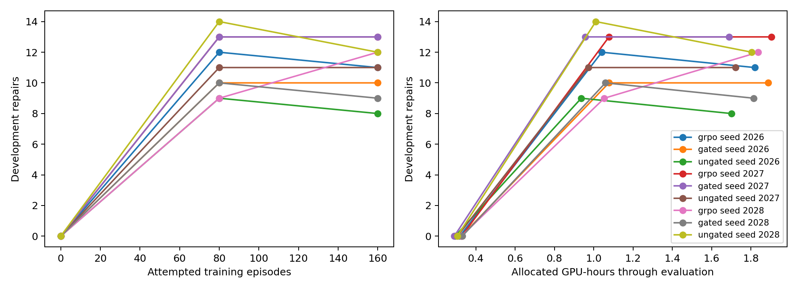

# Task 14 research decision

The structured proposer improves verified, history-novel task yield, particularly at the B200 snapshot. It has not established a general improvement in student mixed-reward yield. At matched student exposure, this experiment does not show that gated OPSD outperforms GRPO. The bounded structured online A/B runs are useful diagnostics, but the available counterfactuals do not justify full C/D alignment training. These are development and training-only findings; the final held-out set remained closed.

## Proposal and repair protocol

A prospective comparison used four samples each on 40 training parents excluded from the earlier probe. At the base snapshot, structured edits produced 90/160 verified proposals and 34 unique parent/mutation pairs, versus 58/160 and 22 for diff. The paired unique difference was +0.30 per parent (parent-bootstrap 95% interval −0.025 to +0.60). At the checksummed B200 snapshot, history-novel verified pairs were 28 structured versus two diff, a paired difference of +0.65 per parent (95% interval +0.40 to +0.925). Structured generation used 236 versus 763 H200-seconds in the B200 comparison. Its finite mutation vocabulary is narrower; higher yield does not establish equivalent mutation coverage.

Student rollouts qualify that result. At base, both formats yielded seven mixed groups, from 22 diff and 32 capped structured tasks; parent-macro structured-minus-diff mixed fraction was 0.00 (95% parent-bootstrap interval −0.33 to +0.33, 12 shared parents). At B200, structured yielded four mixed groups from 28 novel tasks versus zero from two diff tasks. The latter comparison has only one shared parent. These samples do not support a general claim that the format improves mixed-group rate.

Function-body replacement made more edit actions valid but repaired fewer tasks: base 2/64 versus 7/64 for diff, and B200 1/64 versus 20/64. The student protocol therefore remained unified diff, selected on training-only tasks. See the [detailed investigation](task14-informative-selfplay.md) for intervals, selection rules and reproduction commands.

## Matched student controls

All arms used the same frozen 32-task training pool and schedule, common initialization within seed, 160 attempted episodes, and evaluations after 0, 80 and 160 episodes. Ungated OPSD's coefficient was fixed at **0.0077736624** using eight separate training-only tasks to match the initial aggregate gated distillation gradient strength; gated used 0.1. This matches initial aggregate strength, not later gradients or optimizer displacements. Final development scores are successes out of 41:

| Seed | GRPO at 80 / 160 | Gated at 80 / 160 | Ungated at 80 / 160 | Final student steps: GRPO / gated / ungated | Total H200-hours: GRPO / gated / ungated |
|---|---:|---:|---:|---:|---:|
| 2026 | 12 / 11 | 10 / 10 | 9 / 8 | 8 / 20 / 20 | 1.824 / 1.891 / 1.704 |
| 2027 | 13 / 13 | 13 / 13 | 11 / 11 | 9 / 20 / 20 | 1.908 / 1.692 / 1.725 |
| 2028 | 9 / 12 | 10 / 9 | 14 / 12 | 10 / 20 / 20 | 1.843 / 1.818 / 1.808 |

At 160 episodes, cumulative generated student tokens (GRPO / gated / ungated) were 77,192 / 72,387 / 72,572 for seed 2026; 74,519 / 73,378 / 73,288 for 2027; and 74,040 / 72,925 / 82,512 for 2028. All initial scores were 0/41; no proposer steps occurred in the static controls. At 160 episodes, the mean paired parent-macro difference across seeds was **−4.35 percentage points** for gated minus GRPO (three-seed t 95% interval −15.15 to +6.45 points), and −5.07 points for ungated minus GRPO (−13.32 to +3.18). These intervals are very uncertain with only three seeds; they do not prove equivalence or a disadvantage. The arms used similar total allocation ranges, but the differences in optimizer steps and stochastic trajectories remain part of the comparison. The compute-axis curves include initialization and evaluation time.

[Download the learning curves as PDF](../figures/task14-matched-student-learning-curves.pdf). Private event records and the exact allocation manifest are under `runs/task14/static-all-seeds*`; rerun `uv run python scripts/analyze_task14_static.py --manifest runs/task14/static-all-seeds-manifest.json --output runs/task14/static-all-seeds` after fetching those records. The analysis checks common pool, schedule, calibration, initial adapters and complete evaluation sets; it resamples development parents within seed and reports a separate seed-level interval.

## Bounded online A/B and reward identification

Both structured-proposer arms used the new immutable study `repair-selfplay-2026-task14-online-v1`, execution `a3f9d0a446319e6e91bad1071ff89c360c8ec480`, the same initial adapters and parent schedule, and 20 iterations. The online A/B contrast preserves the original ungated/gated coefficient of 0.1; it is not the calibrated static ungated arm. Both scored 0/41 initially, 13/41 at iteration 10 and **12/41 at iteration 20**. A yielded 57/320 verified proposals and 228 student episodes; B yielded 54/320 and 216. A had nine mixed student groups and B 12. Both took 18 student and 18 proposer steps. A had 16 parent groups with multiple verified candidates and three with distinct valid rewards; B had 13 and two. The results are single-seed and unequal-exposure, so they do not isolate a student-method effect.

The training-only counterfactual used the same proposer snapshot, candidates and student rollouts. Only three parent groups had multiple valid candidates. Under standardized advantages, the actual proposer Adam-update cosine for RL versus combined alignment was 0.9922, while an identical-reward repeat was 0.9954; reference-anchor halves had gradient cosine 0.8146. Mean-centered non-standardized advantages were a labeled diagnostic, not a change to the primary estimator. This small sample and repeat sensitivity do not establish meaningful, reproducible C/D update differences. The bounded A/B diagnostics were justified by the verified proposal yield and mixed groups; their equal 12/41 final scores, unequal exposure and the static results do not by themselves justify a larger A/B continuation. **Do not start full C/D on this evidence.** The next experiment should first collect a prespecified larger set of multi-valid training-only groups and measure repeated counterfactual optimizer updates and anchor stability; if reward discrimination remains too sparse, investigate proposal diversity and task difficulty before extending online training.

A rollout/rescoring mismatch can affect clipping and updates. On saved base diff episodes, 21/5,608 advantage-bearing tokens crossed sign-sensitive clipping; replacing only 84/17,180 outlier denominators in a diagnostic gave combined-gradient/Adam-update cosines 0.825/0.656 versus the true-behavior branch. The diagnostic also changes the distillation gap, so it does not identify a root cause. At B200 the targeted mixed/uniform replay gave 0.930/0.997 with the saved optimizer state. True behavior probabilities were retained in training. These observations limit causal interpretation and motivate further backend diagnosis, not an unvalidated estimator substitution.

## Reproducibility and accounting

The static experiment used `configs/task14.yaml`, `configs/task14-static-control.json`, frozen execution `61cb728b540a63d26ae92f1929b2b8814a56376d`, and seeds 2026–2028. The online settings are in `configs/task14-online.yaml`; all live runs used the accepted isolated worker and the fixed dataset boundary. Both final online checkpoints passed every completion-manifest SHA-256 and matching runtime, scientific and dataset identity; their canonical W&B histories were cloud-verified through iteration 20 ([A](https://wandb.ai/tatsu432s/self-play-opsd-coding-agent/runs/da8f99c54b2951671aa0e8a5), [B](https://wandb.ai/tatsu432s/self-play-opsd-coding-agent/runs/7ec1f41f0ddab3d6db8fd903)). Raw generated candidates, trajectories and oracles remain private.

Slurm recorded **96,336 H200-seconds (26.76 GPU-hours)** across 36 Task 14 GPU jobs: 16.212 hours for nine static controls, 5.828 for online A/B, 4.665 for diagnostics and probes, and 0.055 for the online backend check. This includes 88 seconds from a failed checksum-identity attempt and a cancelled allocated attempt; two further cancelled attempts never started. CPU validations are not GPU-hours. The queue was empty after final reconciliation. The pinned environment, task configurations, analysis scripts, job identities and further provenance are recorded in the detailed investigation, plan and `AGENTS.md`.
