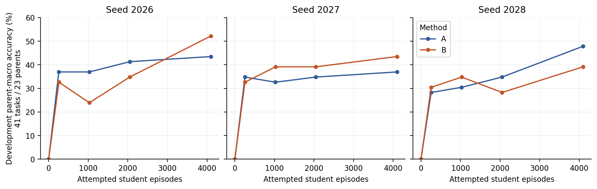
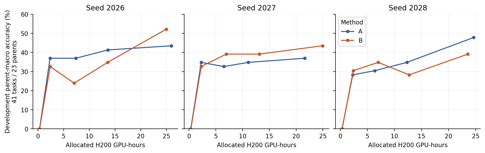
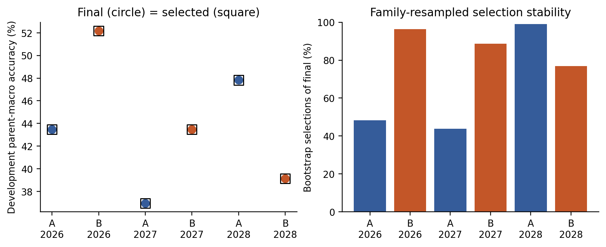
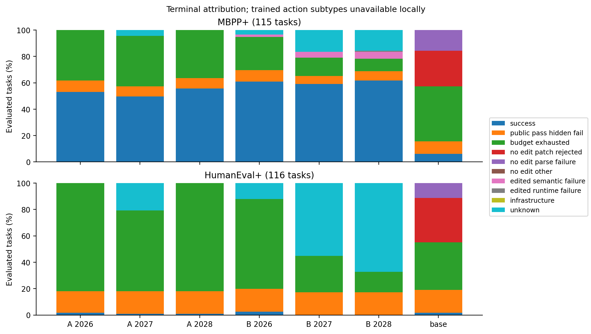
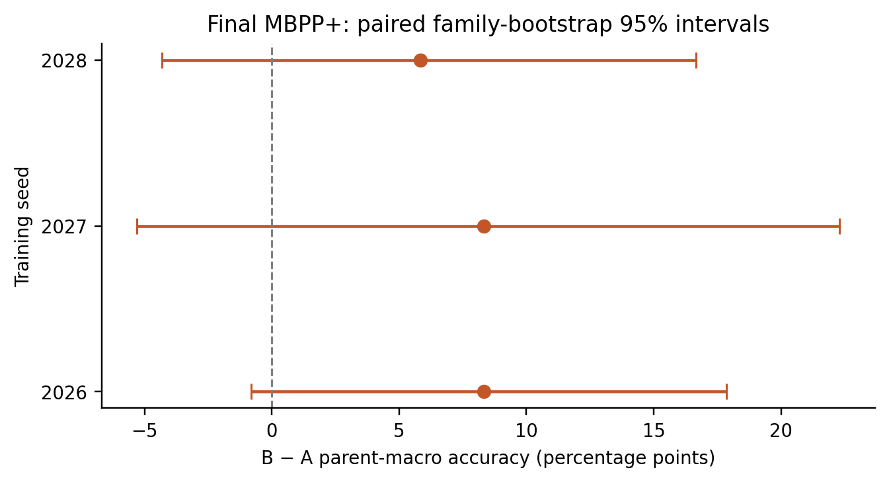
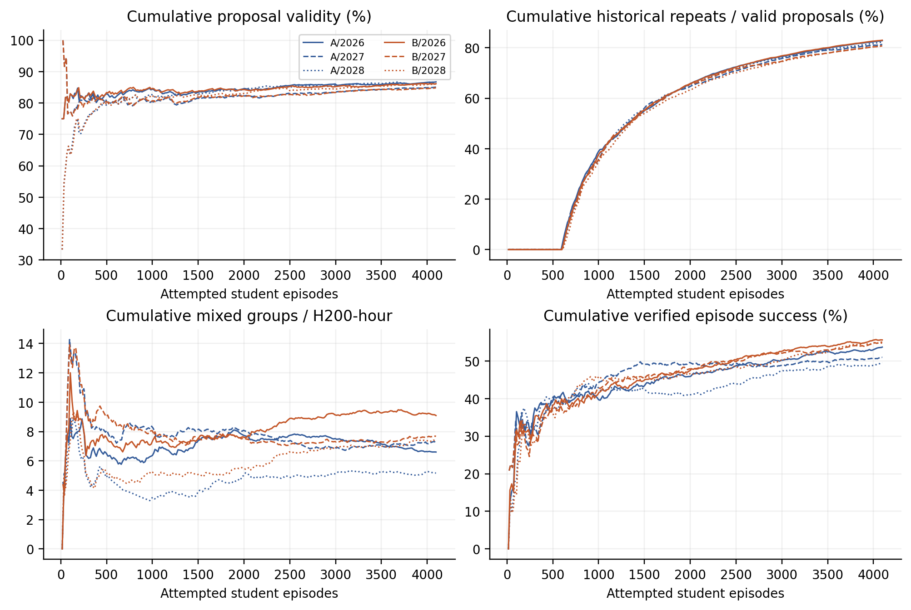

# Task 16: generalization, checkpoints, and the next experiment

The completed A/B study establishes strong improvement on held-out MBPP+-derived repairs and almost no aggregate improvement on HumanEval+-derived repairs. The strongest newly measured transfer difference is that **HumanEval+ episodes almost always retain the initial buggy source and almost never call public tests**, while MBPP+ episodes frequently change the source. The exact trained-model patch/parser mechanism remains unresolved because their trajectory shards are unavailable locally and Yale DNS access failed.

The requested development selector chooses **the final checkpoint in all six arms**. These observations do not support an earlier-checkpoint intervention or a diagnosis of terminal validation overtraining. No GPU job was submitted. Compute evidence is budget-dependent: B has a better available-checkpoint frontier at the largest common allocated-hour budget in each seed, but it does not dominate every earlier budget, threshold, token budget, or development endpoint.

This is a retrospective exploratory analysis of frozen study `repair-selfplay-2026-task15-ab-v2`, execution `0ac77cde4bc5f70ba2b3eb9e457749e3106a2bc5`. Historical Task 15 results and W&B runs were not modified. Implementation and all independent local analyses are finished; trained action-subtype attribution and live checkpoint/scheduler reconciliation remain incomplete pending Yale access.

## Dataset and evaluation audit

All 306 frozen reference/development/final tasks regenerate exactly with their recorded deterministic mutation seeds. The parent/family audit passes; parents were assigned before mutation generation. The reserved training population has 186 parents, of which 127 have eligible structured mutation sites after the frozen exclusion. Admitted reference, monitoring, diagnostic, final ID and external task counts are 14, 41, 20, 115 and 116; their covered parent counts are 14, 23, 10, 60 and 116. Reservations and actually admitted tasks are different quantities.

Final splits share the four-action interface, frozen greedy decoding, eight-turn and common token budgets. Both use `fixed_mutation`; online training uses structured AST proposals. The common arithmetic/comparison/constant vocabulary does not make their task distributions equivalent. The matching historical executed oracle-validation report covers all 306 tasks, with correct originals passing and mutants having semantic failures; this report was reused, not rerun. Current frozen source hashes and task-file checksums are verified locally.

Parent-macro means avoid counting multiple mutations from one parent as independent:

| Feature | MBPP+ final ID | HumanEval+ external |
|---|---:|---:|
| Source lines, including docstrings | 5.00 | 17.63 |
| Source lines after removing docstrings | 5.00 | 7.25 |
| AST nodes | 48.78 | 66.26 |
| Branch/loop/comprehension nodes | 1.33 | 2.22 |
| Public cases | 3.12 | 2.98 |
| Hidden cases | 104.22 | 764.91 |
| Specification characters | 92.17 | 429.05 |

Much of the raw line-count difference is docstring text: HumanEval+ has a mean 381.7 docstring characters, while these MBPP+ programs have none. Executable structure still differs, but raw lines alone would overstate it. Public-example counts are similar; this contradicts a simple "far fewer examples" explanation, without establishing equal usefulness. Hidden-case counts differ substantially and are not a measure of independent semantic coverage or intrinsic difficulty.

Fresh isolated final verifications of source-hash-identical initial mutants recover initial public/hidden behavior without executing code again. They cover all 116 external tasks: 96 fail public tests, 114 fail hidden tests, and 20 pass public tests while failing hidden tests. Of 108 recoverable ID mutants, 97 fail public and 106 fail hidden tests. The seven remaining ID tasks and reference/development mutant detection profiles require additional isolated evidence. Original sources and cases remain private.

## Final outcomes and failure evidence

The common base scores 7/115 ID and 2/116 external. Trained scores reproduce Task 15 exactly. Table entries count final source changes and public test actions; source retention does not exclude transient edits later undone.

| Model | ID repairs /115 | ID source changed /115 | ID test calls | External repairs /116 | External source changed /116 | External test calls |
|---|---:|---:|---:|---:|---:|---:|
| Base | 7 | 7 | 6 | 2 | 2 | 6 |
| A 2026 | 61 | 68 | 96 | 2 | 3 | 1 |
| B 2026 | 70 | 76 | 91 | 3 | 3 | 3 |
| A 2027 | 57 | 65 | 100 | 1 | 1 | 4 |
| B 2027 | 68 | 79 | 99 | 0 | 0 | 0 |
| A 2028 | 64 | 70 | 103 | 1 | 1 | 1 |
| B 2028 | 71 | 81 | 94 | 0 | 0 | 0 |

Trained ID episodes average 5.83–6.59 turns and 460–815 generated tokens. External episodes average 7.41–8.00 turns and 1,026–1,851 tokens. Thus weak transfer coincides with longer, less testing-oriented episodes, not fewer generated tokens. Turn/token/context limits are distinguished in the private overlapping diagnostics; they must not all be called context exhaustion.

The terminal taxonomy prioritizes success, confirmed infrastructure failure, public-pass/hidden-fail, recorded budget exhaustion, no-edit patch rejection, no-edit parsing failure, other no-edit failure, edited semantic/runtime failure, then unknown. It describes terminal evidence, not a causal root cause. All observed action errors remain separate flags. A failed `finish` is not automatically labeled premature. Public-pass/hidden-fail can occur on the untouched initial mutant and does not imply that a valid patch was applied.

| Model | ID: success / public-pass-hidden-fail / budget / other-or-unknown | External: success / public-pass-hidden-fail / budget / other-or-unknown |
|---|---|---|
| Base | 7 / 11 / 48 / 49 | 2 / 20 / 42 / 52 |
| A 2026 | 61 / 10 / 44 / 0 | 2 / 19 / 95 / 0 |
| B 2026 | 70 / 10 / 29 / 6 | 3 / 20 / 79 / 14 |
| A 2027 | 57 / 9 / 44 / 5 | 1 / 20 / 71 / 24 |
| B 2027 | 68 / 7 / 16 / 24 | 0 / 20 / 32 / 64 |
| A 2028 | 64 / 9 / 42 / 0 | 1 / 20 / 95 / 0 |
| B 2028 | 71 / 8 / 11 / 25 | 0 / 20 / 18 / 78 |

There are no recorded final infrastructure failures and no denominator exclusions. Trained exact action counts, rejected patches and final-turn tool-error subtypes are unavailable. Base trajectories are complete: ID has seven valid patch applications versus 331 rejected applications and 172 parsing failures; external has two versus 408 and 166. These base measurements establish a substantial interface bottleneck for the base; they do not establish its exact trained-model contribution. The failure figure visibly distinguishes categories unavailable for trained episodes.

Within-seed A/B ID overlaps (both / only A / only B / neither) are 54/7/16/38, 43/14/25/33, and 54/10/17/34. A retains all seven base ID successes in every seed. B retains seven, six and six, adding 63, 62 and 65 previously unsolved tasks. On external tasks, A retains one, zero and zero of the base's two successes and gains one new task per seed; B retains one, zero and zero and gains two, zero and zero. This is task-level regression evidence on very few successes, not proof of broad catastrophic forgetting.

Paired ID parent-macro B-minus-A effects and family-bootstrap 95% intervals (2,000 replicates, deterministic seed 2026) are:

| Seed | Difference (percentage points) | Family-bootstrap interval |
|---|---:|---:|
| 2026 | 8.33 | [-0.81, 17.86] |
| 2027 | 8.33 | [-5.30, 22.31] |
| 2028 | 5.83 | [-4.31, 16.67] |

The separate three-seed mean is +7.50 percentage points, with a t-based 95% interval [+3.91, +11.09]. Three seeds provide weak support for the interval's population assumptions. Family/parent uncertainty and seed uncertainty answer different questions. External results remain near the base floor; point estimates cannot identify an intrinsic benchmark difficulty or a causal gating effect.

Descriptive mutation/operator, public-case, line-count and structural-complexity strata are exported privately. Successes remain too sparse externally for a credible unregularized multivariable explanation. Post-outcome action variables are analyzed as behavioral diagnostics, not causal pre-task predictors.

## Development selection and overtraining

Exactly five evaluations per arm are observed: baseline and the four actual milestone crossings, including 260/1,028/2,052/4,100 episode overshoots where present. The monitoring-only selector maximizes parent-macro accuracy across 23 parents and selects the earliest measured checkpoint on ties. It selects the final checkpoint in every arm:

| Arm | Iteration | Episodes | Development task successes /41 | Parent-macro accuracy | H200-hours through evaluation | Bootstrap selection of final |
|---|---:|---:|---:|---:|---:|---:|
| A 2026 | 241 | 4096 | 15 | 43.48% | 25.943 | 48.25% |
| B 2026 | 245 | 4096 | 19 | 52.17% | 24.990 | 96.40% |
| A 2027 | 239 | 4096 | 12 | 36.96% | 21.606 | 43.85% |
| B 2027 | 242 | 4096 | 16 | 43.48% | 24.929 | 88.70% |
| A 2028 | 244 | 4096 | 17 | 47.83% | 24.652 | 99.05% |
| B 2028 | 236 | 4100 | 14 | 39.13% | 23.555 | 76.95% |

The selected-minus-final effect is exactly zero on these observations because they identify the same checkpoint. B's development-selected endpoint exceeds A in seeds 2026 and 2027, but A is higher in 2028. There is no observed terminal development decline in any arm. Earlier dips occur (for example B-2028 falls from 8/23 parent-equivalent successes at 1,028 episodes to 6.5/23 at 2,048 before ending at 9/23); they do not establish persistent overtraining.

Joint family resampling reruns the selector across all checkpoints. Final selection is much less stable for A-2026/A-2027 than for several other arms; the 41 tasks are not 41 independent parents. Out-of-bootstrap selected-minus-final mean differences range from −0.35 to −7.50 percentage points. These are selection-stability diagnostics with small, variable omitted-family sets, not independent holdout estimates or bias-free confidence intervals. Searching a few milestones cannot establish a globally optimal checkpoint. No earlier-checkpoint GPU evaluation is warranted by the specified rule. Current checkpoint files are not local; their historical checksum verification remains documented in Task 15, while fresh Yale verification is blocked.

## Sample and compute efficiency

Training allocation costs reconcile to 145.723889 H200-hours, including interrupted segments and replayed work. Queue time is excluded; initialization and evaluation within allocations are included. A/B costs by seed are 25.951/24.998, 21.614/24.938 and 24.660/23.563 hours. B is cheaper at the final exposure in two seeds and more expensive in one. Final generated training tokens A/B are 2,112,165/2,066,597; 1,692,242/1,973,718; and 1,941,426/1,957,017.

The following is a checkpoint-availability comparison: each arm may choose its best *measured development checkpoint* within the same budget. It is not an evaluation of each evolving model at that exact wall-clock time, and no interpolation or extrapolation is used.

| Seed | Largest common measured hour budget | A available development parent accuracy | B available development parent accuracy | B − A |
|---|---:|---:|---:|---:|
| 2026 | 24.990 | 41.30% | 52.17% | +10.87 pp |
| 2027 | 21.606 | 36.96% | 39.13% | +2.17 pp |
| 2028 | 23.555 | 34.78% | 39.13% | +4.35 pp |

B has the better observed availability frontier at these terminal common hour budgets. These are descriptive point differences after development selection; they do not carry an independent significance claim, and checkpoint-selection noise can affect them. This does **not** establish uniform compute dominance: the earliest observed 35% development threshold favors A in 2026 (2.373 versus 24.990 hours), B in 2027 (6.942 versus 21.606), and B slightly in 2028 (23.555 versus 24.652). Thresholds are exploratory and crossings may occur between the sparse observations. At the largest common token budget, available B-minus-A development differences are +10.87, +2.17 and −13.04 pp. There is no consistent token-budget advantage. Student-step budgets are descriptive because steps differ in episode/token content.

At an exact 4,096-episode cutoff, B-2028's final 4,100-episode point is unavailable. The primary study's explicitly allowed overshoot is retained; it would be misleading to claim a new exact-equality measurement or interpret the preceding checkpoint as its 4,096-episode policy. Final ID episode-matched evidence remains favorable to B in all three seeds, while development and compute definitions need separate qualifications.

Committed scoring timings attribute approximately 1,695–1,884 seconds per arm to teacher scoring, 2,076–2,304 to unprivileged scoring, and 2,155–2,400 to proposal generation. These omit discarded work, initialization and some unrecorded phases; they are not allocation costs or a counterfactual overhead estimate against GRPO. Missing development-phase timings remain null.

## Training signal and proposer behavior

| Arm | Verified student repairs / episodes | Mixed groups / groups | Mixed groups per allocated hour | Valid proposals / attempts | Distinct-valid-reward proposer groups / attempted groups | Historical repeated valid samples |
|---|---:|---:|---:|---:|---:|---:|
| A 2026 | 2200/4096 | 169/1024 | 6.51 | 3001/3460 | 49/865 | 2486 |
| B 2026 | 2278/4096 | 224/1024 | 8.96 | 3060/3552 | 65/888 | 2540 |
| A 2027 | 2086/4096 | 155/1024 | 7.17 | 2879/3384 | 60/846 | 2342 |
| B 2027 | 2254/4096 | 189/1024 | 7.58 | 2987/3520 | 52/880 | 2413 |
| A 2028 | 2029/4096 | 126/1024 | 5.11 | 2921/3380 | 43/845 | 2403 |
| B 2028 | 2243/4100 | 172/1025 | 7.30 | 2810/3264 | 63/816 | 2269 |

All six arms have zero fallback groups. Cumulative curriculum mutation counters end at only 220–254, despite 2,810–3,060 valid proposals and 1,024–1,025 trained task groups per arm. Historical repetition and within-update repetition overlap; their counts must not be added as disjoint failures. A zero rejected-duplicate count does not imply novelty, because Task 15 intentionally admits historical repeats.

Proposal validity rises from 72.8–81.2% in the first measured window to 87.4–89.2% in the last. Student repair success rises from 27.7–32.0% initially to 52.5–63.3% in the last window. Mixed-group fractions fluctuate and mostly decline from early values; B supplies more mixed groups per allocated hour than A in each seed. Training success and mixed-group yield are different quantities.

B has fewer invalid training actions than A in every seed: invalid fractions A/B are 49.30/45.41%, 46.30/43.61%, and 52.17/44.09%. Total action counts are recovered from the recorded turn-distribution mean × count; action-type and successful/rejected-patch breakdowns still require trajectories. OPSD can update on uniform groups, so their zero current GRPO advantage does not imply zero total gradient or zero optimizer displacement. The per-candidate nonzero-advantage counter cannot reconstruct nonzero proposer-group fractions; those remain missing.

These observations show increasing validity and repair proficiency on the realized narrow curriculum. They do not identify a causal contribution from proposer learning: there is no matched frozen-proposer comparison, and repetitions dominate valid samples. Only 5.1–7.7% of attempted proposer groups distinguish difficulty rewards among valid candidates. Increased structured validity has not removed the reward-identifiability concern underlying deferred C/D.

## Ranked explanations and research decision

1. **Failure to achieve a useful final edit on external tasks is the best-supported behavioral mechanism.** Only 0–3 external final sources change per run; public-test actions are 0–4 versus 91–103 on ID. Base traces directly exhibit extensive patch rejection. Counterevidence/limits: trained traces are missing, and unchanged final code does not prove that every attempted patch was rejected. Exact parser, hunk/context and transient-edit mechanisms remain unresolved.
2. **Distribution shift in representation and task structure is a plausible contributor.** External programs carry much longer specifications/docstrings, somewhat more executable structure and far more hidden cases. Public-case counts are similar and 96/116 initial mutants visibly fail public tests, so wholesale hidden-only bugs or missing public examples cannot explain the floor. Specification usefulness and patch-context effects need a controlled comparison.
3. **A weak base floor and a narrow repeated curriculum constrain transfer.** The base solves only two external tasks; training gains ID proficiency largely on repeated MBPP-derived mutations. There are small observed external regressions and gains, but too little initial capability to establish broad forgetting. A causal curriculum benefit or deficiency requires matched snapshots/tasks, not these evolving runs alone.
4. **Public-test insufficiency explains a subset, not the overall failure.** Twenty external initial mutants already pass public tests; trained public-pass/hidden-fail counts remain about 19–20. Most external final sources are untouched, so this pattern is not evidence that many valid semantic repairs overfit public tests.
5. **Terminal overtraining and infrastructure failure lack supporting evidence here.** Final development points maximize the specified selector, and every final denominator is complete. Sparse development evaluations cannot exclude unmeasured peaks or subtler forgetting. No recorded infrastructure failures does not prove equal task difficulty.

The next step is to recover the existing trained trajectories, then conduct a **narrow repair-interface investigation on training-only tasks** in a separate future study. Freeze one trained B snapshot and the common base; use the same prespecified parent/task/rollout seeds to compare the current interface with one representation change motivated by the recovered failure subtype. Preserve public/hidden oracles and budgets, measure accepted edit actions separately from verified repairs, and hold final test sets out of interface tuning. Saved-output parser/context replay should precede new model sampling wherever possible. Do not repeat the already negative function-body replacement comparison without a distinct supported hypothesis.

Write up the completed A/B findings now, including the external failure and causal limits. Defer full C/D: Task 14's RL-versus-combined proposer update cosine (~0.992) was close to an identical-reward repeat (~0.995), and the current counts still show limited valid-reward discrimination. A later C/D pilot would need identical frozen snapshots/tasks, restored optimizer state, repeated counterfactual updates and disjoint reference estimates before any full training recommendation. No such pilot, training or generation study was launched here.

## Reproduction, coverage, and limitations

Run from this repository with the pinned environment and local frozen tokenizer:

```bash
uv run python scripts/analyze_task16.py \
  --manifest /private/tmp/selfplay-task15-v2/runs/task15/manifest.json \
  --data data/protocol-v3 \
  --base /private/tmp/selfplay-task15-v2/runs/task15/base \
  --output runs/task16/analysis \
  --figures docs/figures/task16 \
  --tokenizer "$HOME/.cache/huggingface/hub/models--Qwen--Qwen3-4B-Instruct-2507/snapshots/cdbee75f17c01a7cc42f958dc650907174af0554"
```

The default is 2,000 bootstrap replicates with seed 2026. The command hashes every consumed file; the private manifest records exact sources and missing dependencies. All 1,617 final/base outcome records and 1,447 active training commits are analyzed. Local trajectory coverage is 231/1,617 final/base episodes (the complete base only); trained proposal/student trajectory coverage is zero. Complete final outcome metrics support the source/test/termination comparisons without those shards. Missing action detail remains null rather than being converted into a failure or a zero.

Yale inspection failed with `Could not resolve hostname bouchet.ycrc.yale.edu`. Current Slurm/account state and fresh checkpoint integrity therefore remain unverified. Restoring Yale network/VPN/DNS access, then normal `uv run selfplay hpc login` if necessary, is the external dependency. No job was submitted or duplicated. After access is restored, reconcile `hpc inspect` and each existing ledger, then fetch records and the generated validated relative-path lists. For example:

```bash
uv run selfplay hpc inspect
uv run selfplay hpc fetch 033b9d537c8ee9c23dc09038
uv run selfplay hpc fetch 033b9d537c8ee9c23dc09038 \
  --trajectory-list runs/task16/analysis/fetch/033b9d537c8ee9c23dc09038.json
```

Repeat the two fetch commands for the six run IDs in `trajectory-fetch-manifest.json`; no `--full` is needed. Re-run the analysis with `--run-root runs/hpc/yale-hpc-cpsc4880` to use those fetched copies. Inspect the retained checkpoints on Yale rather than bulk-copying model weights. A new unchanged analysis run can fill the action-dependent gaps; no retraining or test-based checkpoint selection is needed.

## Figures

Circles mark actual measured development evaluations. Connecting segments guide the eye and are not additional measured points. Allocation axes include training-job initialization/evaluation and interrupted work. The checkpoint availability and threshold tables above use measured checkpoints without interpolation. All figure data are privacy-safe aggregates.













Each figure also has a vector PDF alongside its PNG. Validation, artifact hashes, exact execution status and remaining work are in the [completion record](../task_completion/16-implemented-generalization-checkpoint-analysis.md).
