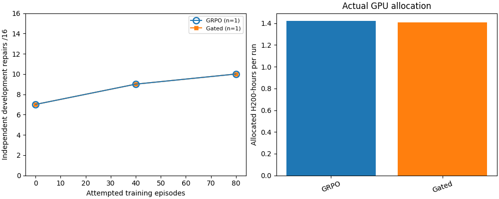

# Task 17 controlled student objectives — in progress

The [frozen study specification](../task/17-objective-comparison-spec.md) uses
exact text, a common fixed curriculum and an 80-attempted-episode endpoint.
This document records actual results; objective superiority is not yet measured.

## Calibration

The initial calibration allocation failed after four saved rollouts because the
backend did not supply an `update_norm` metric. Its run `11610fb16bd9af1f197221b1`
(job `32872812`) is archived, including the original ledger; it consumed 265
H200-seconds. The corrected runner measures actual adapter displacement and
restores adapter/optimizer state after each diagnostic update. Focused tests cover
normal and exceptional restoration. A new matching CPU runtime check passed.

Corrected calibration run `06982710d021357786a605aa` (job `32877712`) completed
32 rollouts over eight distinct reserved training families. It used 556
H200-seconds. The gated squared gradient-norm sum was 0.1054657523 and the
ungated-unit squared sum 120.4827979370, yielding matched initial coefficient
**0.02958647361953192**. Its artifact SHA-256 is
`704e1fad2b53daa360dce14a53ba359689bdc50a21bb5870f8c8230f5d0280fc`.
Twenty-five of 32 calibration rollouts passed; calibration outcomes are not
independent evaluation results. The final control is immutable for continuation
and has SHA-256 `1969665967250fa8e7d8698c9b7f8de4042bec2a97a1c28fae5b5efc38a2e091`.

## Seed-2026 bounded pilots

| Objective | Baseline monitoring | Baseline independent development | Rollout successes | Mixed groups | Optimizer updates | GPU-seconds |
|---|---:|---:|---:|---:|---:|---:|
| GRPO | 21/41 | 7/16 | 26/32 | 5/8 | 3 | 1,851 |
| Gated OPSD | 21/41 | 7/16 | 27/32 | 3/8 | 4 | 1,904 |

Both baseline outcome sets match task-by-task. The objective run manifests also
match in initial adapter, model, pool, tasks, seed, interface, budgets, prompt,
control and scientific code. Rollout outcomes are on-policy training data, not
an independent objective comparison. Both pilots stopped cleanly at iteration 4;
the complete joint checkpoints' metadata and file checksums were verified.
All recorded gradients were finite. One uniform-reward GRPO iteration produced
no update; gated OPSD produced an auxiliary-driven update on the corresponding
uniform-reward first iteration. This is a mechanistic observation, not evidence
of superior generalization.

The maximum rollout/rescoring log-probability differences were 1.1153 (GRPO)
and 0.8137 (gated); each iteration emitted a mismatch warning. The original
behavior-policy denominators remain intact, and the causal impact is unknown.
Matched continuation to 40 and 80 episodes is warranted by nonzero learning
signals, but any conclusion must account for this numerical limitation.

GRPO continuation `32898057` completed exit 0 at 80 episodes, consuming 3,268
additional H200-seconds. Its monitoring curve was 21/41 → 25/41 → 25/41; its
independent-development curve was 7/16 → 9/16 → 10/16. At 80, three original
failures became successes and none of the original successes regressed. It made
five optimizer steps over 80 episodes; 54/80 training rollouts succeeded, with
seven mixed groups out of 20. The maximum scoring difference reached 2.9407;
0.59% of sampled tokens in that iteration differed by more than 0.2. The final
checkpoint files and metadata were checksum-verified. These are single-seed
development observations, not an objective comparison.

Gated continuation `32908569` completed exit 0 in 3,168 H200-seconds; its
iteration-10 checkpoint files and metadata were verified. At 0/40/80 episodes,
monitoring was 21/27/28 out of 41 and independent development was 7/9/10 out of
16. GRPO was 21/25/25 and 7/9/10, respectively. At the endpoint each method
solved one independent task the other missed. The gated-minus-GRPO paired
difference was 0/16 with a family-bootstrap 95% interval of −18.75 to +18.75
percentage points, conditional on seed 2026. On monitoring, the
parent-macro difference was +6.52 points across 23 families, with a 95%
family-bootstrap interval of −10.87 to +23.91 points. These development sets
and one training seed cannot establish equivalence or robust superiority.

GRPO/gated used 1.422/1.409 H200-hours and generated 24,990/22,481 training
tokens respectively. On-policy training success was 54/80 versus 58/80;
these are not independent evaluations. GRPO made five updates with seven mixed
groups out of 20; gated made ten updates with six mixed groups. Maximum
behavior/rescoring differences were 2.9407 and 1.8313, respectively. Gated's
auxiliary updates on uniform groups establish a difference in learning signal,
not a causal generalization advantage. The unchanged behavior denominators and
unverified impact of scoring differences remain limitations.



Both pilots and the full seed-2026 pair support proceeding with seeds 2027 and
2028 before interpreting training-seed variation. GRPO seed-2027 job `32917167`
(run `95735e5ad673444230f30717`) was submitted once to 80 episodes; its pending
wall was reduced to three hours, with its original reservation retained. Inspect
its ledger and never duplicate it. It failed before training after 70 H200-seconds
because the trainer checked seed-2027 initialization against a study-wide
seed-2026 record. The failed directory and original ledger are archived. The
corrected trainer preserves the seed-2026 path and uses seed-specific records
for later Task 17 objective seeds. This is an initialization-bookkeeping code
revision; model, objective math, data and exposure are unchanged. Revalidate the
changed code passed matching CPU validation. A distinct corrected seed-2027
GRPO replacement was submitted once as job `32920928` / run
`f479a008edceec432c10d1eb`; its pending wall was reduced to three hours while
retaining the original six-hour reservation. Inspect it and never duplicate.
Report the two scientific-code hashes explicitly when pooling seeds. Total Phase 2 allocated time is **11,082
H200-seconds (3.07833 GPU-hours)**, including both failed allocations. The objective analysis is at
`runs/task17/objective-analysis-seed2026-v4/`; its family-bootstrap interval
reflects task sampling conditional on one training seed, not seed variation.

## Seed-2027 replication in progress

After the archived seed-isolation failure, corrected GRPO job `32920928` / run
`f479a008edceec432c10d1eb` completed exit 0 at 80 episodes in 4,908
H200-seconds. Monitoring was 21/41 → 22/41 → 26/41 and independent development
was 7/16 → 8/16 → 8/16 at 0/40/80 episodes. Ten training iterations and all
three development milestones were fetched. Endpoint checkpoint identity and all three file checksums were verified; the
paired comparison remains pending. Matched gated job `32931504` / run
`72a763ad7097ffd776f2ef54` was submitted once and is pending. The 2027
scientific-code change only isolates seed-specific initialization records;
model, objective mathematics, data and exposure are unchanged. Completed Phase 2
allocations total 15,990 H200-seconds, including both failures. A dry-run
attempt to use a scheduler dependency was rejected because dependencies are
limited to interface operations; it submitted no job.

## Two-seed replication

The matched seed-2027 gated run `72a763ad7097ffd776f2ef54` (job `32931504`)
completed exit 0 in 4,834 H200-seconds; its endpoint checkpoint identity and
file checksums passed. Its monitoring curve was 21/26/29 out of 41 and its
independent development curve was 7/8/8 out of 16. Matched GRPO scored
21/22/26 and 7/8/8. Both independent baselines matched task by task, and both
arms solved exactly the same eight independent tasks at 40 and 80 episodes.
At 80 episodes gated alone solved three monitoring tasks. Family-macro paired
monitoring difference was +0.0652, family-bootstrap 95% interval [0, 0.1304];
this interval conditions on seed 2027. Gated gradients were finite in all ten
iterations; its maximum rollout/rescoring difference was 2.8961. The impact of
this mismatch is unresolved. Neither the zero independent difference nor its
zero-width empirical interval demonstrates equivalence.

Across seeds 2026 and 2027, both arms reached 10/16 and 8/16 independent
repairs respectively. [Learning curves and allocation](../figures/task17/objective-learning-efficiency-two-seeds.png)
use actual Slurm charges, including the 70-second failed seed-2027 GRPO attempt.
These are two training seeds, with family-bootstrap task uncertainty reported
separately; causal and population claims require more evidence. The completed
Phase 2 allocation totals 20,824 H200-seconds, including calibration and both
failed allocations. Seed-2028 GRPO job `32940325` / run
`bcca1b8b4d205d2ae64e311d` has been submitted once and is pending.

## Seed-2028 GRPO endpoint

GRPO job `32940325` / `bcca1b8b4d205d2ae64e311d` completed exit 0 in 4,902
H200-seconds; its endpoint checkpoint identity and all three file checksums
passed. Monitoring was 21/15/24 out of 41 at 0/40/80 attempted episodes;
independent development was 7/6/9 out of 16. At the midpoint, seven original
monitoring successes were lost and one was gained. The final results recovered,
but the intervening regression remains important. All ten gradients were finite
(three zero-current-gradient batches); maximum scoring mismatch was 1.6529.
Matched gated job `32948815` / `c28f8436ea7fb25863e13330` was submitted once
and is pending. Completed Phase 2 jobs total 25,726 H200-seconds, including
calibration and failed attempts. Dependency-matching worker and runtime evidence
has been prepared for the remaining ungated controls. Seed-2027 calibrated
ungated student job `32949054` / `33169d7814bd4982be57365c` was then submitted
once, alongside the pending gated 2028 job, with both six-hour reservations
within the Phase 2 ceiling. It uses the identical seed-2027 scientific code
and calibrated coefficient; this is not a full proposer C study.

## Three-seed GRPO/gated comparison and calibrated control

The third paired gated endpoint `c28f8436ea7fb25863e13330` (job `32948815`)
completed exit 0 in 4,929 H200-seconds with its checkpoint verified. Its
monitoring curve was 21/25/31 and independent curve 7/8/10, versus GRPO's
21/15/24 and 7/6/9. At 80, gated alone solved one additional independent task;
it solved nine monitoring tasks GRPO missed and missed two GRPO solved. The
family-macro monitoring difference was +0.1304, family-bootstrap 95% interval
[−0.0652, +0.3043].

Across seeds 2026–2028, independent endpoint scores for gated versus GRPO were
10/10, 8/8 and 10/9 out of 16. These are three seeds and the same fixed tasks,
not independent replications of the test set. Per-seed family bootstrap is
conditional on the training seed. [Curves and allocated time](../figures/task17/objective-learning-efficiency-three-seeds.png)
include actual Slurm charges and the failed 2027 attempt.

The calibrated ungated seed-2027 student control `33169d7814bd4982be57365c`
(job `32949054`) completed exit 0 in 4,765 H200-seconds with verified endpoint.
Its monitoring curve was 21/26/33 and independent curve 7/8/9. At 80 it solved
one independent task gated missed; gated solved no task it missed. Its paired
monitoring advantage over gated was +0.0870 family macro, family-bootstrap 95%
interval [−0.0217, +0.2174]. This is one seed and is not conclusive. Both
calibrated and gated gradients were finite; maximum scoring mismatch was 0.9187
and 1.2569, respectively. Its causal significance remains unknown.

Nominal ungated seed-2027 job `32956169` / `b61e831028a66f9a447ba5bf` and
calibrated seed-2028 job `32956243` / `29dfbeda3055a7ad827da642` have each
been submitted once and are pending. Completed Phase 2 allocations total
35,420 H200-seconds, including calibration and failures; original reservations
for these jobs remain inside the 24-hour ceiling. These are student controls,
not full proposer C/D studies.

## Reproduction after endpoints

Fetch each existing run with `uv run selfplay hpc fetch RUN_ID`, verify its
checkpoint and scheduler/ledger identities, and create a private manifest with
`runs` entries `{arm, seed, run_dir, allocated_gpu_hours}`. Hours must sum actual
Slurm allocations for that logical run, including failed/interrupted attempts;
retain the accounting evidence. Do not include a run before its endpoint is
complete. Then use a fresh output directory:

```bash
uv run python scripts/analyze_task17_objectives.py --manifest runs/task17/objective-manifest.json --pool runs/hpc/yale-hpc-cpsc4880/86e2df49bb04a9321f7d755d/pool.json --control configs/task17-objective-control.json --output runs/task17/objective-analysis-v1
```

The script checks the final control, initial adapter pairing within seed, shared
scientific configuration, full exposure and development milestones. When seeds
use different scientific-code hashes, the manifest must explicitly provide
`scientific_code_hash_by_seed` and a `code_compatibility_note`; paired arms for
each seed must still use exactly the same hash. Its family
bootstrap is conditional on each training seed; training-seed variation is
reported separately. Private source and per-task records remain under `runs/`.
