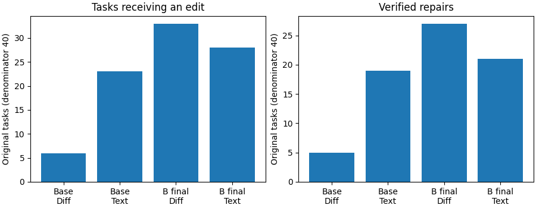
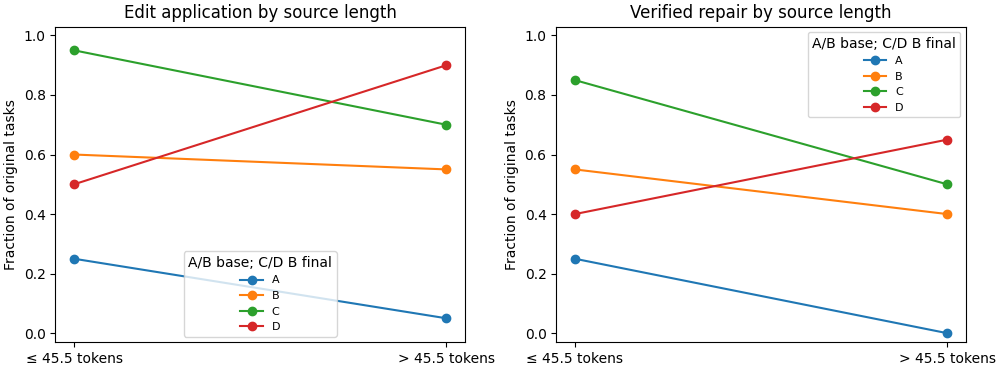
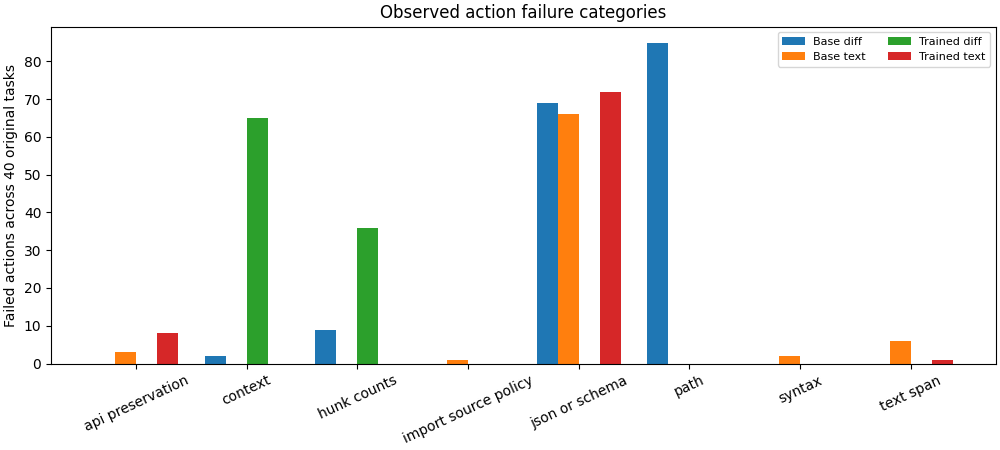
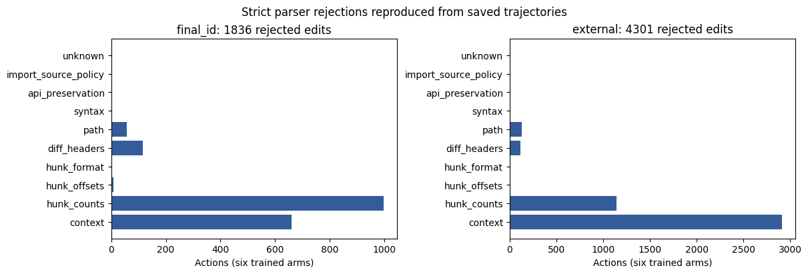
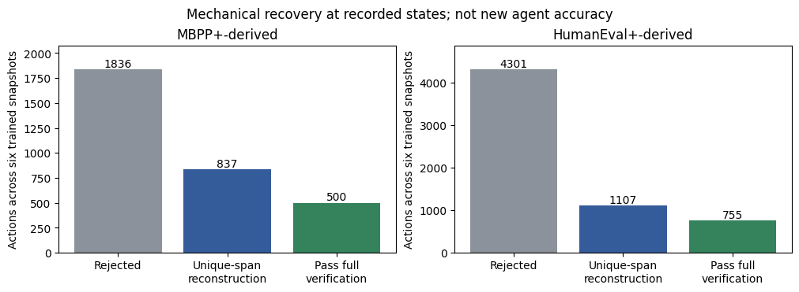

# Task 17: repair encoding and controlled objective study

## Paired primary results — retrieved after Yale login

All four complete artifacts and Slurm records were retrieved and analyzed in
`runs/task17/interface-analysis-v1/`. On 40 original training families, base
strict/text verified 5/40 and 19/40: paired difference +35 percentage points,
family-bootstrap 95% interval +17.5 to +50. Trained B2026 strict/text verified
27/40 and 21/40: difference −15 points, interval −35 to +5. Tasks with an
applied edit were 6/40 versus 23/40 for base, and 33/40 versus 28/40 for B2026.
These are single-checkpoint results; the trained difference is uncertain. The
56-presentation results below are exploratory. Exact text and an 80-episode
endpoint were selected for the fresh-base objective study; its results are
reported separately in [objective results](task17-objective-results.md). Total actual GPU use was 1.15 H200-hours.

On originals, base strict/text had 7/108 versus 25/76 accepted edit
attempts, 101 versus 51 rejected edits, and 4 versus 27 public-test calls.
Trained strict/text had 42/143 versus 37/107 accepted edit attempts, 101 versus
70 rejected edits, and 39 versus 35 public-test calls. Edit attempts are not
independent samples. Original generated-token totals were 24,066/18,994 for the
base and 21,295/11,343 for B2026; turn totals were 308/275 and 249/226.
In the exploratory 20-family source-length strata (median 45.5 tokens), base
repair differences were +30 points at/below the median and +40 above it; trained
B2026 differences were −45 and +15, respectively. These small strata and
multiple comparisons are exploratory, not proof of a causal length interaction.
Schema familiarity and differing model conditioning are plausible explanations
for the trained snapshot's response, not experimentally isolated causes.







Failure categories count actions, including non-edit actions, over the 40
original tasks. They are not independent task samples. Reproduce with
`scripts/plot_task17_errors.py` using the paired analysis and the frozen pool.

## Earlier snapshot before retrieval (historical)

Mechanical replay establishes a substantial encoding bottleneck in the saved
trajectories. It does not measure new end-to-end agent accuracy. The four matched
frozen-model allocations completed sequentially and consumed **4,140 allocated
H200-seconds (1.15 GPU-hours)**. Complete strict-control artifacts are local;
final text artifacts and ledgers were not retrieved before Yale VPN/SSH access
expired. The last successful remote inspection observed completion markers,
56 episodes per cell and the aggregate counts below. Primary 40-task paired
text effects, uncertainty and the interface choice remain pending. No Phase 2
calibration or training, normalized-diff model experiment, or full C/D training
has run. See the [current research decision](task17-research-decision.md).

| Cell | Snapshot / interface | Repairs, all 56 presentations | Primary repairs /40 | Allocated H200-seconds |
|---|---|---:|---:|---:|
| A | Base / strict diff | 6 | 5 | 1,234 |
| B | Base / exact text | 26 | Retrieval pending | 928 |
| C | B2026 / strict diff | 36 | 27 | 1,121 |
| D | B2026 / exact text | 31 | Retrieval pending | 857 |

The 56-presentation endpoint includes correlated variants and is exploratory.
Its aggregate base gain and trained decline cannot replace the prespecified
40-family paired comparison or establish an interface decision. Do not infer
missing original-task counts from these totals. A/C completion artifacts and
execution identity are checked locally; B/D aggregate observations still require
artifact/ledger reconciliation. Full job/run identities are in the
[execution record](../task_completion/17-implemented-repair-interface.md).

## Retrospective evidence

The checksummed Task 16 inputs reproduce **all 1,617** final/base trajectories,
11,516 actions. The six trained snapshots contribute 1,386 episodes. Reconstruct
only complete, uniquely matching old hunk context; ignore coordinates/counts,
leave added/removed content unchanged, and reject ambiguous/overlapping/reordered
hunks or unsafe headers. Reconstruction never consults the correct solution.
Syntax/source/API admission precedes isolated semantic verification. Each edit
is tested at its recorded source state; later saved actions are not a valid
counterfactual continuation.

| Six trained snapshots | MBPP+-derived repair | HumanEval+-derived repair |
|---|---:|---:|
| Episodes | 690 | 696 |
| Accepted / rejected patches | 613 / 1,836 | 13 / 4,301 |
| Unique-context metadata recoveries | 864 | 1,132 |
| Recoveries passing static admission | 837 | 1,107 |
| Reconstructed actions passing full verifier | 500 | 755 |
| Distinct passing task/program pairs | 80 | 118 |
| Episodes with a passing reconstructed state | 193 | 249 |
| Originally failed episodes with such a state | — | **242** |

CPU job `32794598`, run `9d9776357a4e23ae82cd34dc`, verified all 1,991
admitted trained/base actions using **449 distinct task/program verifier calls**.
Identical programs reuse the recorded outcome. The base contributes 13/14
passing ID and 25/33 passing external reconstructions, spanning six and ten
episodes respectively. Across trained external snapshots, correct reconstructed
states cover 96/116 parent problems; repeated actions and snapshots are not
independent tasks. No oracle solution is used to choose or reconstruct an edit.

Among the 242 originally failed external episodes with a correct reconstruction,
the earliest passing reconstructed edit is at turn two in 138 cases; its median
position is turn two. In those 138 cases it is also the first schema-valid edit
attempt. Later turns might have changed after a valid tool response, so this
locates the bottleneck without measuring saved turns or new agent accuracy.
Additional turn-position output is in private
`runs/task17/semantic-replay-analysis-v2/`, from the same isolated replay results.

The external state-recovery counts also vary substantially by frozen snapshot:

| Snapshot | Original verified repairs /116 | Tasks with a correct reconstructed state /116 |
|---|---:|---:|
| Base | 2 | 10 |
| A-2026 | 2 | 15 |
| A-2027 | 1 | 63 |
| A-2028 | 1 | 51 |
| B-2026 | 3 | 34 |
| B-2027 | 0 | 47 |
| B-2028 | 0 | 39 |

The columns are different endpoints, not before/after agent accuracies. A correct
reconstruction need not include an originally successful episode (none of the
ten base episodes succeeded originally). The near-zero strict endpoint therefore
understates the observed ability to propose useful edits. This does not establish
how later actions would change after a successful tool response, or isolate a
training-objective effect. Unique reconstructed programs, not repeated actions,
pass in 118/234 trained external task/program pairs.

| First deterministic rejection | Trained MBPP+ | Trained HumanEval+ |
|---|---:|---:|
| Context mismatch | 661 | 2,913 |
| Hunk counts | 997 | 1,141 |
| Hunk offsets | 7 | 0 |
| File headers | 115 | 116 |
| Forbidden paths / extra file content | 56 | 131 |

Action acceptance falls with source length within MBPP+: 396/694 edits (57.1%)
for tasks at/below 35 source tokens versus 217/1,755 (12.4%) above that median.
HumanEval+ is near its floor in both strata: 13/2,230 versus 0/2,084 at a
173-token median. All 13 accepted external patches also lie below the median
specification length (115.5 tokens). These are confounded action-level
associations, not causal length effects. MBPP+ tasks with at most one branch
accept 488/1,181 edits versus 125/1,268 with more branches. The reproducible
private stratified table also covers mutation type/sites, public-case count,
preceding turn, method and each checkpoint/seed; source and specification
features overlap. Reproduce with `scripts/analyze_task17_strata.py` against
`runs/task17/recovery-full-v1/`, using a new output directory.

In the trained external trajectories, tasks with at most three public cases
had 13/2,944 accepted edits and those with more than three had 0/1,370. Across
mutation categories, `Eq→NotEq` had 2/1,004 accepted and constant-value changes
5/1,636; other categories have smaller samples. Method A had 10/2,196 accepted
versus B's 3/2,118. These describe repeated actions from six distinct trained
runs, not independent trials or a gating effect. No edits among 1,962 attempts
at zero-based turns 0–3 were accepted, versus 13/2,352 at turns 4–7; turn-level
composition and survivor effects prevent a causal interpretation. The saved
strata also report each checkpoint and mutation operator.

Secondary admission after metadata recovery rejects another 27 ID actions
(26 syntax failures, one API change) and 25 external actions (22 syntax failures,
three executable-module source-policy violations). Their original first error
was patch metadata; they are excluded from semantic replay.

The static parser reproduces errors even where historical final-turn tool
observations were absent. Categories describe the first rejection and can mask
later defects. Another 50 ID and 215 external actions fail JSON/schema parsing.
Repeated unchanged-source/error-category attempts beyond the first total 1,153 ID
and 3,226 external. This is broader than identical-action repetition.





These results reject an explanation based solely on semantic inability for at
least 242 recorded external failures. They do not quantify a causal improvement
under a changed tool prompt, prove all failures are syntactic, or establish new
HumanEval generalization. H1–H4 await the matched comparison; a mixed syntactic
and semantic explanation remains possible.

## Frozen-model comparison and admission

The [implementation specification](../task/17-repair-interface-spec.md) defines
base and checksum-verified B2026-final snapshots × strict diff and exact text,
identical greedy budgets/oracles, 40 primary training-only families and 16
exploratory presentation variants. Curriculum, calibration and independent
development reserve 40/8/16 other families. No model outcome selects parents.

Initial preparation `32794599` / `6be54fe0c6ab8d8a6c492675` lacked admissible
mutations for seven reserved parents. Revised preparation uses 32 bounded fixed
attempts, caches identical mutants and refills from unused families. Job
`32797537` / `0522e9eae55f829aadc11294` verified all 104 originals, then failed
variant verification. Diagnostic job `32801929` /
`f0b3c13f22f1fdbd0aa7e20b` found that `Mbpp/599`'s mutant exhausted the fixed
allowance in a comment variant, original recheck and variant repeat: 90 runtime
failures and zero semantic failures each. Inputs reach approximately 100 million; the cause of
timing variation from initial admission is unproven. Exclude it before inference
and use the next reserved family, retaining the other 103 admissions.

Replacement preparation `32804290` / `86e2df49bb04a9321f7d755d` completed exit 0 from
execution `8654b20`. Failed preparation directories and original ledger bytes
remain archived with updated artifact locations and archive histories. No
historical Task 15 task, oracle, checkpoint or result was changed.

CPU runtime checks `32792142` and `32793248` completed successfully;
preparation performs current runtime validation itself. The text runtime check
`32809208` also completed. The accepted existing isolated worker is reused.
During final fetching, VPN disconnected and the expired SSH master could not be
refreshed. The stale normal Duo login attempt was stopped; no new allocation was
submitted. Restore normal VPN/SSH access to retrieve existing results.

## Reproduction

```bash
uv run python scripts/analyze_task17.py --recovered runs/task16/recovered-analysis-verified --data data/protocol-v3 --output runs/task17/recovery-full-v1 --figures docs/figures/task17
uv run python scripts/analyze_task17_replay.py --audit runs/task17/recovery-full-v1 --replay runs/hpc/yale-hpc-cpsc4880/9d9776357a4e23ae82cd34dc --output runs/task17/semantic-replay-analysis --figures docs/figures/task17
```

Use a fresh directory for each rerun. Full coverage, input checksums, original
outcomes and final-source reconstruction are enforced. Private task/source/case
artifacts stay ignored under `runs/`; public plots contain aggregates only.
Replay candidates SHA-256:
`37f01a4e83c7522e97c4936f44ec1a1cd56411ef62cad430896593c5bbf65f8f`.
See the [execution plan](../plan/17-repair-interface-plan.md) and
[completion record](../task_completion/17-implemented-repair-interface.md).

Prepared pool SHA-256: `602eaf506f8ac2cf17924596dae7c0ff3891ef5034a546d4d3751b9803412c83`.
All 120 rows passed tokenizer admission under both protocols. Rejected GPU
submission `dc2a6394ef94ef1bd7768b1e` has no scheduler job or charged allocation.

The four cells ran from immutable checkouts with common scientific-code hash
`87514655114a2b57e02a43f713e378d9b0939163f13c8a898f9046f8619816f4` and
prompt-definition hash
`9b9a987260cce5ca0d7a1a773c776658a0fad844cc9999fd37826db17948d464`.
Actual model conditioning differs by interface. Execution commits are
`e6e7412` (A), `843187f` (C), and `26749ad` (B/D); operational changes did not
change these scientific dependencies. New optional normalization and conditional
student code has a new identity and cannot reuse those old runtime proofs as if
it had been executed.

After restoring normal Yale VPN access, use:

```bash
uv run selfplay hpc login
uv run python scripts/collect_task17_interfaces.py
```

The collector fetches only these four existing runs, validates terminal statuses,
reads actual `sacct` allocations without double-counting typed/general GPU TRES,
and invokes `analyze_task17_interfaces.py`. It writes statuses atomically and
refuses to replace an earlier analysis directory. No job is submitted. The
analysis binds each actor's provenance to its immutable scheduler specification;
it does not compare historical execution to the current checkout's code hash.

The retrieved strict controls show:

| Snapshot / presentation | Repairs | Tasks receiving an edit | Accepted / decoded edit attempts |
|---|---:|---:|---:|
| Base / originals | 5/40 | 6/40 | 7/108 |
| Base / source comments | 0/8 | 0/8 | 0/32 |
| Base / specification repetition | 1/8 | 2/8 | 2/29 |
| B2026 / originals | 27/40 | 33/40 | 42/143 |
| B2026 / source comments | 1/8 | 1/8 | 1/51 |
| B2026 / specification repetition | 8/8 | 8/8 | 9/17 |

On the eight selected source-comment parents, B2026 solved 5/8 originals and
1/8 variants (four losses, zero gains). For specification repetition it solved
8/8 in both presentations. Base solved 1/8 originals versus 0/8 source-comment
variants, and 1/8 in both specification presentations. These small training-only
perturbation results suggest sensitivity to source presentation; they do not
isolate length from comment content or establish a HumanEval transfer effect.
In the exact-text runs on those same eight source-comment parents, base
repairs changed from 1/8 originals to 3/8 variants (two gains, zero losses),
and trained B2026 from 2/8 to 4/8 (two gains, zero losses). This small
exploratory interaction is consistent with interface/presentation sensitivity,
but it cannot isolate source length, prompt conditioning or task composition. Public tests were called four times on base originals versus
39 times on trained originals, showing that accepted edits and testing behavior
both differ across snapshots.

Exact text additionally preserves import declarations, while historical strict
diff retains its existing import allowlist. This stricter text admission is part
of the tested interface; its rejection frequency remains to be analyzed.

## Synthetic illustration of the distinction

For a specification “return the input plus one,” suppose the current source is
`def f(x): return x + 2`. A diff that changes `+ 2` to `+ 1` but places its only
hunk at line 99 is semantically useful and rejected by strict coordinates.
Unique exact old-hunk recovery can locate it without consulting a reference
solution. Exact replacement expresses the same change with `old_text: "x + 2"`
and `new_text: "x + 1"`. Replacing it with `"x + 9"` can also pass source/API
admission while remaining semantically wrong. If the old span occurs twice,
exact replacement rejects it rather than guessing. These are synthetic examples,
not additional experimental outcomes.
