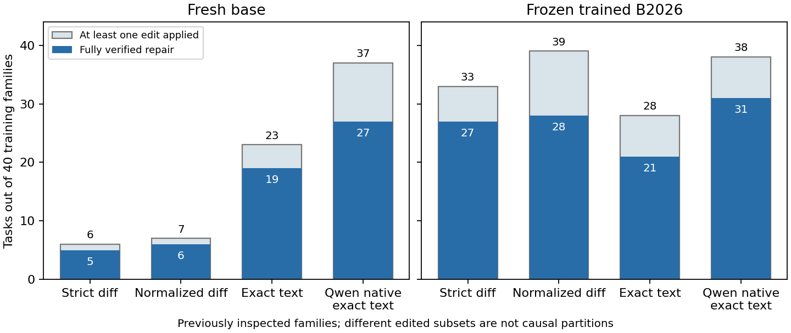
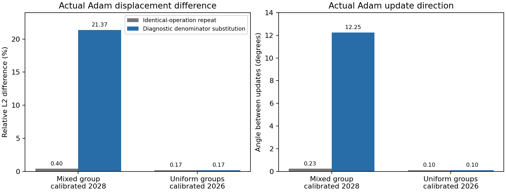

# Task 18 controlled interface and numerical results

Study `repair-selfplay-2026-task18-v1` reuses the verified Task 17 training-only
pool and frozen Qwen3-4B-Instruct-2507 snapshots. New training remains disabled.
The bounded phase is complete: native exact-text editing is selected, with
27/40 base and 31/40 trained repairs. New RL is deferred after a material
numerical sensitivity result. Total new allocation is **4,589 H200-seconds
(1.274722 hours)**, including the first compatibility-failure probe.
See the [execution record](task18-status.md) and
[research decision](task18-research-decision.md).

## Current-state audit

Main was reconciled at `48b48398871519640e0b808e37daa1aec555e002` before
implementation. Completed Tasks 15–17 were reused, including all twelve Task 17
objective arms and the four strict/text frozen-model cells. No historical
training, held-out evaluation or checkpoint selection was repeated. No account
jobs were active at initial reconciliation. The preserved model archive matched
all ten scratch-cache files; no redownload was needed.

The pool contains 104 independent families / 120 rows. Only one originally
reserved eligible parent remains unassigned after preparation replacements.
New interface measurements therefore use the same previously inspected 40
training families. They are development evidence; HumanEval was not retuned or
reevaluated. No untouched transfer/generalization result is claimed.

## Frozen interfaces: common 40 original families

All cells use seed 2026, one greedy episode per family, eight turns, 4,096
generated tokens per episode and unchanged observations/isolated verification.
Historical allocations also evaluated 16 correlated presentation variants;
their whole-allocation hours are not matched-40-task cost measurements.
Token tables count generated targets. Prompt exposure changes with serialization
and is not matched; actual allocation and generated-token costs are reported separately.

| Snapshot / editor | Verified | Tasks edited | Accepted / rejected edit attempts | Valid-schema calls / all calls | Generated tokens | Public / hidden success |
|---|---:|---:|---:|---:|---:|---:|
| Base / strict, reused | 5/40 | 6 | 7 / 101 | 239 / 308 | 24,066 | 12 / 5 |
| Base / normalized, new | 6/40 | 7 | 7 / 93 | 233 / 302 | 23,307 | 13 / 6 |
| Base / exact text, reused | 19/40 | 23 | 25 / 51 | 209 / 275 | 18,994 | 24 / 19 |
| Base / native exact text, new | 27/40 | 37 | 50 / 1 | 216 / 217 | 24,336 | 30 / 27 |
| B2026 / strict, reused | 27/40 | 33 | 42 / 101 | 249 / 249 | 21,295 | 30 / 27 |
| B2026 / normalized, new | 28/40 | 39 | 59 / 36 | 222 / 222 | 13,698 | 32 / 28 |
| B2026 / exact text, reused | 21/40 | 28 | 37 / 70 | 154 / 226 | 11,343 | 27 / 21 |
| B2026 / native exact text, new | 31/40 | 38 | 50 / 3 | 189 / 189 | 13,855 | 35 / 31 |

Calls include reads/tests/finish as well as edits. A valid schema does not imply
an accepted edit, and neither implies repair. Failures after at least one
accepted edit number 1/1/4 for base strict/normalized/text, and 6/11/7 for B2026.
Native failures after an applied edit are 10/40 base and 7/40 trained.
These condition on different selected task subsets and cannot identify a causal
percentage of semantic versus application failures.

| Paired repair difference | Percentage points | 95% family-bootstrap interval |
|---|---:|---:|
| Base normalized minus strict | +2.5 | [0, +7.5] |
| Base normalized minus text | −32.5 | [−47.5, −17.5] |
| Base native minus plain text | +20 | [+2.5, +37.5] |
| Base native minus normalized | +52.5 | [+35, +67.5] |
| Base native minus strict | +55 | [+37.5, +70] |
| B2026 normalized minus strict | +2.5 | [−5, +12.5] |
| B2026 normalized minus text | +17.5 | [0, +37.5] |
| B2026 native minus plain text | +25 | [+7.5, +42.5] |
| B2026 native minus normalized | +7.5 | [−5, +20] |
| B2026 native minus strict | +10 | [−2.5, +22.5] |

Intervals describe task-family resampling conditional on each named snapshot,
not training-seed uncertainty. They are descriptive development intervals:
the full native set includes its eight screening families, and multiple
interfaces were considered. Normalization recovered five base and 29 trained edits, but
added only one verified task per snapshot. Mechanical hunk metadata is insufficient to
explain the base text gain. B2026 normalized diff reduced rejected edit attempts
from 101/143 to 36/95 and generated tokens by 35.7%, while its repair-rate gain
over strict remains uncertain. Historical/new executable identities differ;
default prompt/action parity is tested locally, not inferred from matching counts.

Exploratory source/specification-length and branch-count strata are in the
private paired analysis. Small groups and prior inspection preclude a claim
that any length or complexity subgroup generalizes better.

## Qwen serialization compatibility probe

Eight families were selected by the frozen hash order
`digest(["task18-native", task_id])`. Replace-text semantics, episode budgets,
snapshots and seeds remain fixed. Native schemas enter the pinned tokenizer's
chat template; decoding is unconstrained and actual target IDs remain intact.

The first base probe found a real harness compatibility defect: its parser
rejected assistant text before a valid delimited call. Qwen explicitly permits
additional assistant content alongside tool calls in its
[format documentation](https://qwen.readthedocs.io/en/latest/getting_started/concepts.html#tool-calling).
All 34 rejected replies contained call tags, which are ordinary tokenizer tokens
and were not lost by vLLM detokenization. The probe's 2/8 repairs versus plain
JSON's 4/8 are a harness diagnostic, not a compatible-native comparison.
The corresponding trained allocation was cancelled before starting, with zero
GPU charge and its original ledger retained.

The v2 parser extracts one delimited call with surrounding content allowed.
It preserves all prose/target IDs in history, rejects duplicate/multiple calls,
and delegates argument, path, import and public-API checks to the existing
restricted editor. Corrected cells have new execution/control identities.
No repaired action is retrospectively relabeled as an end-to-end success.

Corrected base/trained probes both repaired **7/8**, versus **4/8** for their
paired plain-JSON controls. All 40 base and 32 trained native calls were valid,
with seven accepted and zero rejected edits per snapshot. Plain controls had
42/53 and 39/44 valid-schema calls. Generated tokens were 3,139 native versus
2,395 plain for base; 1,705 versus 2,534 for trained. These eight-task results
pass both frozen expansion criteria, but are not a full interface selection.
The full comparison reuses the checksum-bound eight episodes and generates
only the remaining 32 per snapshot. New RL remains disabled.

The full base result is **27/40**, including the unchanged 7/8 probe and 20/32
new repairs. Native alone solved 12 tasks plain text missed; plain alone solved
four. Native has 99.54% valid-schema calls and 50/51 accepted edit attempts,
against plain text's 76% and 25/76. Generated tokens increase 28.1%, while
turns decrease 21.1%. Ten tasks fail after an applied native edit; application
remains distinct from semantic repair. These are previously inspected training
families, not new external transfer evidence. The full base allocation used
1,009 H200-seconds; including its probe, native base cost 1,217 seconds.

The full trained result is **31/40**: 7/8 reused plus 24/32 newly generated
repairs. Native has 189/189 valid-schema calls and 50/53 accepted edit attempts.
Compared with normalized diff, it uses 1.15% more generated tokens and 14.9%
fewer turns. Its three-task repair gain over normalized remains uncertain;
normalized is a useful lower-allocation-cost fallback. The trained allocation
used 571 seconds; including its probe, native trained cost 757 seconds.

The prespecified 32-family expansion, excluding the screen, gives:

| Snapshot | Plain text | Native | Difference | Family-bootstrap 95% interval |
|---|---:|---:|---:|---:|
| Base | 15/32 | 20/32 | +15.625 points | [−6.25, +37.5] |
| Trained | 17/32 | 24/32 | +21.875 points | [+3.125, +40.625] |

These families had already been inspected under previous interfaces. Neither
partition is untouched confirmation. The between-snapshot score gap is 22/40
with strict diff and 4/40 with native calling; this descriptive dependence on
conditioning does not identify what training learned or establish OOD transfer.
Native combines the pinned tool schema/template and compatible single-call
parsing with surrounding assistant content. It does not isolate the effect of
XML tags from every other aspect of native conditioning.

## Numerical replay and training decision

The saved-data audit reconciled 120 committed batches across all twelve Task 17
objective arms. It reproduced calibrated-2026 batch 4's maximum log-probability
difference **5.48991494**, with 6/3,346 targets above 0.2 and one sign-sensitive
clipping-branch difference. Its exact checkpoint 3 had already been retired.
No causal optimizer result for that worst batch is available. All 495 saved
calibrated-2026 turn prefixes/lengths passed the pinned-tokenizer check; none
of those six outliers is an EOS token. Eleven recovered trajectory files were
SHA-256 checked remotely before analysis.

Two retained, complete pre-update checkpoints were replayed with their original
calibrated objective/coefficient, both adapters, both optimizers and RNG restored
between branches. Sixteen saved episodes contain 3,842 targets. Actual behavior
denominators are preserved; substituting frozen scorer probabilities is a
counterfactual diagnostic only, with auxiliary coefficients held fixed.

| Quantity | Mixed calibrated-2028 batch 10 | Uniform calibrated-2026 batch 6 |
|---|---:|---:|
| Saved targets | 1,372 | 2,470 |
| Absolute difference >0.2 | 10 (0.7289%) | 12 (0.4858%) |
| Maximum absolute difference | 1.027852 | 1.000000 |
| Active clipping-branch differences | 4 | 0 |
| Gradient cosine, diagnostic vs behavior | 0.936806 | 0.999971 |
| Adam-displacement cosine | 0.977223 | 0.999998 |
| Relative displacement difference | 21.374% | 0.1747% |
| Identical-operation repeat difference | 0.3993% | 0.1743% |

Relative L2 uses the compared reference-vector norm, as defined by the existing
alignment diagnostic; coordinate sign differences include arbitrarily small
coordinates. Three real Adam steps per source were separately restored and
discarded; there were **zero new training updates or new trained endpoints**.
The mixed result exceeds the predeclared 1% / 0.99 screening threshold beyond
repeat variation. Uniform groups have zero GRPO advantages, so their remaining
auxiliary/momentum differences are within repeat variation. Gradient-mode and
frozen scoring agree exactly on all 3,842 tested targets.

A second allocated probe uses the same mixed checkpoint and exact saved targets:

| Scoring comparison, 1,372 targets | Mean absolute | Maximum | Targets >0.2 |
|---|---:|---:|---:|
| Full HF vs original vLLM behavior | 0.003987 | 1.027852 | 10 |
| Incremental HF vs original behavior | 0.002877 | 0.839185 | 6 |
| Incremental HF vs full HF | 0.002383 | 0.431651 | 6 |
| Repeated full HF vs full HF | 0 | 0 | 0 |
| Full HF vs saved frozen scores | 0 | 0 | 0 |

The measured mode was SDPA, BF16 base/FP32 adapter parameters, TF32 disabled and
float32 matmul precision `highest`. Four original unprivileged turns were
sampled using the original seeds in a fresh production vLLM engine. Three
reproduced every target ID (90/65/17 targets); the fourth agreed for four targets
before divergence. On those 176 identical-prefix targets, probability
differences reach 0.219070. The probe generated 189 targets and executed no
generated tool action or Python program.

Fresh turns were sampled individually; the original rollout batch schedule was
not reconstructed. This is an execution-parity probe, not proof that vLLM must
return identical probabilities across different batching schedules.

Execution arithmetic contributes to the mismatch even without changing weights
or token prefixes. A fresh engine does not reproduce every original probability,
so a stale long-lived adapter cache is not a sufficient explanation. These
checks do not isolate every kernel/batching/precision contribution, prove that
no historical state bug ever occurred, or measure downstream learning harm.
They do provide a valid training decision: **do not launch new RL with the
current unexplained, materially sensitive backend discrepancy.** Keep original
denominators. The next numerical experiment should be a separately identified
precision/execution-parity ablation with real repeat-controlled Adam updates,
before any new objective cohort. Production currently hardcodes BF16 in both
FSDP and vLLM; changing model-loading dtype alone is not a valid FP32 test.

## Partial rewards and deferred work

Saved trusted counts recover exact hidden-training fractions for 67/80
calibrated-2026 episodes and conservative logical bounds for 13. Binary rewards
distinguish 7/20 task groups, versus 8 guaranteed informative partial-reward
groups (9 possible). This adds one guaranteed all-binary-failure group. Initial
mutant baselines are available for only six families / 24 episodes, with 11
guaranteed fraction improvements and no guaranteed regression within that
subset. Missing baselines remain unknown. Logical bounds are not confidence
intervals; the saved rollouts are correlated and do not establish learning
efficiency or protection against reward hacking. No extra verifier work was
needed, so a prospective per-case verifier cost was not measured.

Student binary rewards and binary-solve proposer difficulty remain unchanged.
The modest extra reward discrimination does not justify training while the
numerical gate fails. Full C/D, adapter transfer, SFT, new editors, observation
changes and new external evaluation remain deferred. Task 17's matched objective
curves/results are reused in the [objective report](task17-objective-results.md);
no new learning curve is implied by frozen-model interface measurements.

## Allocations and exposure

All rows belong to `repair-selfplay-2026-task18-v1`. Interface rows use Qwen3-4B,
seed 2026 and the same training-only families; trained means the verified B2026
checkpoint. All GPU parents completed exit 0. The first native row is explicitly
a compatibility-failure diagnostic. No new training endpoint was produced.

| Operation / Slurm job | Controller run | New episodes / targets | Verified outcome | H200 seconds (hours) |
|---|---|---:|---:|---:|
| Restored numerical / 33575206 | `7635b59fe85fddd9e88b4c39` | 0 / 3,842 saved targets | 16 saved episodes; six restored/discarded Adam steps | 473 (0.131389) |
| Normalized base / 33575526 | `bd76e6a6fbb83abf263b0d83` | 40 / 23,307 | 6/40 | 925 (0.256944) |
| Normalized trained / 33575845 | `d1e5601f947494053b477b4a` | 40 / 13,698 | 28/40 | 599 (0.166389) |
| Native v1 base / 33576276 | `069afeb246a83ece920c06cb` | 8 / 5,990 | 2/8; parser compatibility failure | 351 (0.097500) |
| Native v1 trained / 33576446 | `4fbbb1272d0b3fd48a2394a4` | 0 / 0 | Cancelled before allocation | 0 |
| Cache/rollout / 33580028 | `dd5cd03f30f77dccaa411e81` | 0 / 189 sampled targets | Four turns; no tool execution or update | 267 (0.074167) |
| Native v2 base probe / 33587596 | `bcab3d7c1784f7df90862f6b` | 8 / 3,139 | 7/8 | 208 (0.057778) |
| Native v2 trained probe / 33587602 | `c540fda607c5768db29fc04d` | 8 / 1,705 | 7/8 | 186 (0.051667) |
| Native base expansion / 33589271 | `02c9b1ee439d1828fa9636ab` | 32 / 21,197 | 20/32; combined 27/40 | 1,009 (0.280278) |
| Native trained expansion / 33589312 | `4e84c405144439f65a0e38ba` | 32 / 12,150 | 24/32; combined 31/40 | 571 (0.158611) |
| **Total** | Nine GPU allocations | **168 new evaluation episodes; 81,375 new targets including rollout probe** | **Zero new training updates** | **4,589 (1.274722)** |

Every frozen-interface row has zero optimizer steps. The numerical six steps
are counterfactual branches restored to the original state, not training.
Runtime jobs 33574512 / 33586413 verified all 306 frozen tasks in the accepted
worker, using 480/445 CPU-allocation seconds and zero GPUs. The second check
followed the parser dependency change; unchanged isolation evidence was reused.

All ten GPU reservation records, including the never-started cancellation, are
reconciled to actual charges in the shared 12-hour ledger. No project-user job
remained active at reconciliation. Other users' account jobs are unrelated.
Raw trajectories, private tests/oracles, model/optimizer tensors and credentials
remain outside Git. Controller, source/checkpoint, episode-copy and remote byte
checksums are verified; see the execution record for immutable commits and
analysis commands. New live W&B cloud history is not claimed; the controller,
local artifacts and scheduler accounting are authoritative.
