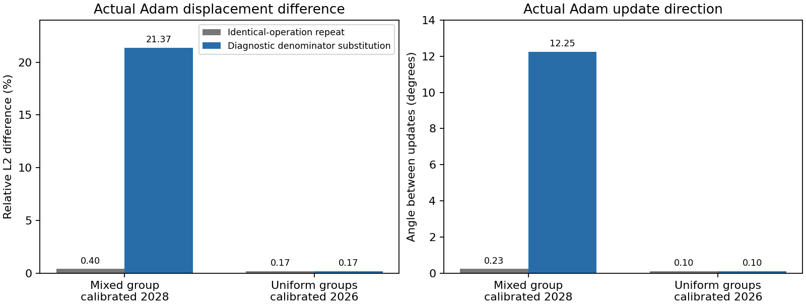
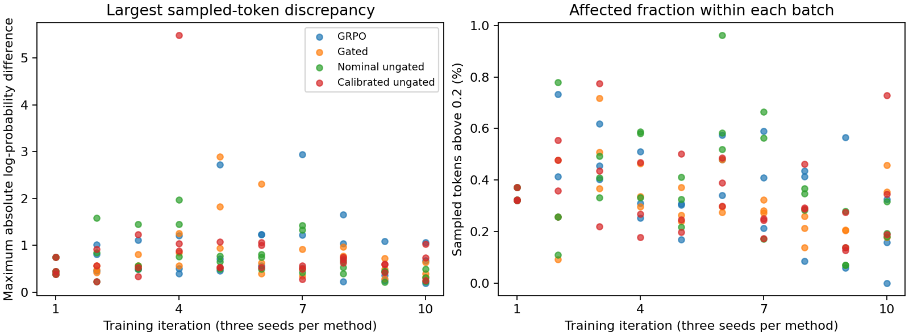

# Task 18: interface and learning-signal investigation

## Current status (2026-11-16)

The native v1 base probe completed with 2/8 repairs versus plain JSON's 4/8 on
the same families. However, all 34 rejected calls contained assistant prose
before a delimited call. The v1 parser incorrectly rejected that content, which
the [Qwen format permits](https://qwen.readthedocs.io/en/latest/getting_started/concepts.html#tool-calling).
This is a compatibility failure, not evidence against compatible native tool use.
The corresponding trained job `33576446` was cancelled while still pending;
retain its immutable ledger and zero-allocation cancellation evidence. A v2
parser accepts surrounding assistant text, retains all sampled IDs/history,
and still rejects multiple calls, duplicate fields and unsafe edit arguments.
Corrected probes require new scientific identities; no old result is overwritten.

Cache/rollout job `33580028` completed exit 0 in 267 H200-seconds. Full scoring
exactly matches saved scores and its repeat on 1,372 targets. Incremental HF
scoring differs from full scoring by up to 0.431651, and from old behavior by
up to 0.839185 (six targets above 0.2). Three fresh vLLM turns reproduce all
target IDs; one diverges after four targets. The identical-prefix probability
differences reach 0.219070. Thus decoding execution differences contribute;
this does not isolate every kernel/state cause or establish a numerical repair.
The valid training decision is to defer new RL, preserving behavior denominators.

Implementation and local validation are underway on
`feat/18-interface-signal-bottlenecks`, from main `48b4839`. The study is
`repair-selfplay-2026-task18-v1`, with a **hard 12 new allocated H200-hour cap**
including failures and continuations. Historical Tasks 15–17 remain complete
and unchanged. The numerical replay is complete; interface and backend follow-up conclusions
remain pending. Training is disabled in the
checked-in control until numerical and interface evidence supports it.

Yale login was refreshed successfully and live inspection found no active
account jobs. All ten files in the existing scratch model snapshot matched the
preserved project's `SHA256SUMS`; no model files were downloaded or restored.

## Numerical replay result and bounded follow-up

Job `33575206` / run `7635b59fe85fddd9e88b4c39` completed exit 0 in **473
H200-seconds (0.131389 hours)**. Both original complete checkpoints and their
checksums were loaded and verified; every diagnostic restored both adapters,
both optimizers and RNG. Sixteen saved episodes were replayed with no new
sampling. Frozen rescoring reproduced the saved discrepancy distributions;
gradient-mode scoring matched frozen scoring on all 3,842 target tokens.



| Restored-state update comparison | Mixed calibrated-2028 batch 10 | Uniform calibrated-2026 batch 6 |
|---|---:|---:|
| Diagnostic denominator-substitution cosine | 0.977223 | 0.999998 |
| Diagnostic relative update difference | 21.374% | 0.1747% |
| Identical-operation repeat relative difference | 0.3993% | 0.1743% |

The mixed batch exceeds the predeclared 1% / 0.99 screen beyond repeat noise.
Its 10/1,372 tokens above 0.2 include four active clipped-surrogate branch
changes; the corresponding gradient cosine is 0.936806. This is a material
conditional update effect, not proof of harm or a reason to replace true
behavior denominators. The uniform groups have zero GRPO advantages and serve
as a control; any diagnostic displacement difference there is numerical repeat
variation in the unchanged auxiliary update and restored momentum.

New RL remains disabled. The current control now selects a separate bounded
cached-scoring/frozen-rollout diagnostic against the mixed checkpoint. It
compares full-sequence versus incremental KV-cache scoring on the exact saved
IDs and replays up to four original unprivileged turns through a fresh vLLM
engine with their original seeds. Comparisons stop at the first differing token;
no generated action or Python program is executed. This is a new scientific
execution, not a continuation of the completed replay or a historical study.
Numerical follow-up allocations now reserve 30 minutes, based on the measured
473-second full replay. The original replay's reservation history is preserved.

## Saved-data findings

The read-only audit reconciles all 12 Task 17 objective endpoints and their
120 committed iteration events. A sampled-token maximum exceeds 0.2 in 119
batches; the affected-token fraction ranges from zero to 0.9622%. These are
batch statistics, not an estimate of harmful optimization.

The calibrated-2026 training shards were retrieved separately, without copying
checkpoint tensors locally. Direct saved-array analysis reproduces iteration
4's maximum 5.48991494, with 6/3,346 tokens above 0.2. One sampled token changes
the active clipped-surrogate branch relative to a ratio-one diagnostic. This
is not a measured gradient or optimizer-update effect. The exact generating
checkpoint 3 was retired; retained checkpoints 0/5/9 match batches 1/6/10.
Task 18 therefore targets calibrated-2028 batch 10 (a mixed-reward group) and
calibrated-2026 batch 6 (uniform-reward controls) for restored-state GPU replay,
retaining each original objective, coefficient and both optimizer states.
Neither replay can establish the worst batch's causal effect. All 495 saved
calibrated-2026 turn prefixes and token/probability lengths passed a CPU check
with the pinned tokenizer; none of its six >0.2 outliers was an EOS token.



The final Task 17 pool contains 104 independent families and 120 rows including
presentation variants. Only one originally reserved eligible parent remains
unassigned after preparation replacements; it is not a new confirmation set.
All new interface comparisons reuse previously inspected training families.

## Completed normalized-diff comparison

Both normalized cells completed exit 0 with matching frozen snapshots, pool,
primary task sets, and controller/allocated-node identities. Base job `33575526`
used 925 H200-seconds; trained job `33575845` used 599. No old cell was rerun.

| Verified repairs /40 primary families | Fresh base | Trained B2026 |
|---|---:|---:|
| Strict diff, reused Task 17 | 5 | 27 |
| Normalized diff, new | 6 | 28 |
| Exact text, reused Task 17 | 19 | 21 |

Normalized-minus-strict paired family-bootstrap 95% intervals are [0, +7.5]
percentage points for base and [−5, +12.5] for trained; both point differences
are +2.5 points. Normalized-minus-text is −32.5 points [−47.5, −17.5] for base
and +17.5 [0, +37.5] for trained. These are task-family intervals conditional on
the named snapshots, not uncertainty across training seeds. All families were
previously inspected. The base applied an edit on 7/40 tasks, with five metadata-
recovered edits; strict applied edits on 6/40, and text on 23/40.

Metadata recovery alone does not explain the fresh-base text gain. The trained
snapshot's point scores still favor its familiar diff interface, with substantial
uncertainty. Native probes are pending; do not select a new training interface
from the eight-family probe alone. Historical cells used 56 rows including
presentation variants, so whole-allocation times are not matched-40-task cost
comparisons. Primary token/turn metrics are reported on the common 40 only.

The six-cell private analysis is `runs/task18/interface-analysis-normalized/`;
it validates controller completion, code/prompt/data/allocation identities,
paired coverage and budgets, then reports outcomes, rejection taxonomy and
exploratory length/structure strata. Different historical/new code identities
remain explicit; prompt/action parity is locally checked, and historical
cross-revision comparisons retain that limitation.

Completed Task 18 GPU allocations total **1,997 H200-seconds (0.554722 hours)**.
The two native probes and cached/frozen-rollout diagnostic remain pending.
The follow-up is job `33580028` / run `dd5cd03f30f77dccaa411e81`, from `0d55297`.
Its pending wall was reduced 30→20 minutes to permit shorter backfill; the
original half-hour reservation and adjustment record are preserved. Never
resubmit these existing jobs. Training remains disabled.

## Partial-reward evidence without new verification

A new saved-count analysis covers calibrated-2026's 80 historical rollouts / 20
training-family groups. It recovers exact hidden-training pass fractions for
67 episodes and conservative logical bounds (not confidence intervals) for the other 13. Public-test observations
are used only for the identical source with no final runtime failure; otherwise
unknown public/hidden allocation of failed cases remains an interval.

Binary rewards distinguish 7/20 groups. Hidden-fraction bounds guarantee
variation in 8/20, with one additional informative all-binary-failure group;
9/20 could vary given the unresolved intervals. Initial-mutant baselines are
observed for only six families (24 episodes), with 11 guaranteed fraction
improvements and no guaranteed regression within that subset. These are
correlated saved rollouts from one training run, not new repairs, a causal
training comparison, or generalization evidence. The modest extra signal does
not justify displacing the interface investigation. Binary student rewards and
binary-solve proposer difficulty remain unchanged. No verifier/model/GPU work
was needed for this analysis.

## Queued allocations — never duplicate

| Operation | Controller run | Slurm job | Scope | Dependency |
|---|---|---:|---|---|
| Numerical replay | `7635b59fe85fddd9e88b4c39` | 33575206 | Two original complete-state batches | None |
| Normalized base | `bd76e6a6fbb83abf263b0d83` | 33575526 | 40 primary families | None |
| Normalized trained | `d1e5601f947494053b477b4a` | 33575845 | 40 primary families | afterok 33575526 |
| Native base | `069afeb246a83ece920c06cb` | 33576276 | Eight primary families | afterok 33575845 |
| Native trained | `4fbbb1272d0b3fd48a2394a4` | 33576446 | Eight primary families | afterok 33576276 |

All five were reconciled PENDING on November 16. The numerical and normalized
base jobs await priority/capacity; their start estimates fluctuate and are not
guarantees. The three dependent jobs wait for successful predecessors. The
four interface cells are sequential; only the independent numerical diagnostic
can overlap them. Every allocation requests one H200.

The numerical pending wall was reduced from two to one hour based on prior
measured replay times; its original two-hour reservation and ledger adjustment
remain. Each interface reserves half an hour. Direct summation of the five
locked reservation records is **4.0 H200-hours of the 12-hour ceiling**;
the completed numerical job is charged at 473 seconds; other outcomes remain
pending. This four-hour figure describes the initial reservations. The persisted convenience total can lag the last
reservation, so reconciliation uses reservation/charge entries themselves.

After a job becomes terminal, inspect its existing ledger, fetch its artifacts,
verify completion/checkpoint identity and actual scheduler charges, and analyze
before deciding further work. A failed predecessor leaves children waiting;
reconcile those existing jobs instead of submitting replacements. Training is
still disabled. The research task and merge to main remain pending these results.

## Implementation and decisions

- Extend existing numerical helpers with distribution, clipping-branch,
  repeat-controlled gradient/sign and actual Adam displacement diagnostics.
  Restore both adapters, both optimizers, RNG and model mode after every branch
  and after failure. Rescored denominators are diagnostic only.
- Use existing normalized diff for the missing fresh-base/B2026 comparisons,
  with the same strict prompts and observations. No new editor is introduced.
- Add opt-in Qwen-native serialization with the pinned tokenizer's `tools`
  argument, exact sampled IDs, single-call parsing, and existing action/path/
  import/API validation. Tool serialization is separate from editing semantics.
- Task 18-only configuration binds the control checksum and serialization to
  scientific identity. Historical configuration hashes remain unchanged;
  changed runtime code has a new code/prompt identity and is never a historical
  continuation. Historical interface controls require behavioral parity and are
  otherwise contextual evidence.
- Extend the existing controller, worker launch and transactional continuation
  paths. One locked Task 18 budget spans operations, seeds, readiness GPU work,
  failures and continuations. No historical budget is imported.
- Task 18 runtime proof covers data/verifier dependencies, model revision and
  numeric observation/sequence budgets; full code, prompt, image and worker
  identities remain bound. It does not certify loss math or native generation.
  A matching proof can cover interface/objective arms without repeating the
  unchanged full dataset audit for each arm.

The first matching CPU runtime allocation is job `33574512`, controller run
`96daa9183384957cd9ea58b5`, submitted once from `dd068f0`, completed exit 0.
Its ledger remains authoritative; never duplicate it. Its verifier evidence can be reused after
changes confined to learning runners only when every file in the explicit
verifier dependency list and every non-code runtime identity still matches the
archived executed checkout. Changed verifier dependencies require a new check.

Local validation passed **450 tests**, with 20 skipped and 18 deselected.
Ruff lint/format and mypy (55 source files) passed. These checks include actual
small-model Adam restoration and cached pinned-tokenizer prefix/EOS tests; they
are not GPU research results. The full suite includes saved-reward and cached-scoring checks.

## Frozen execution sequence

1. Reconcile Slurm and existing logical-run ledgers, synchronize a clean commit,
   reuse unchanged worker containment, and run one matching CPU runtime check.
2. Replay the two checksum-bound historical batches under their exact complete
   checkpoints. Compare fresh scoring, gradient-mode scoring, repeat updates
   and diagnostic denominator substitution. Relative update difference above
   1% or cosine below 0.99 beyond repeat noise requires investigation; passing
   this screen alone cannot enable training.
3. Run normalized diff on 40 primary families for base and B2026. Run native
   exact-text serialization on eight deterministic families per snapshot.
   Expand native to 40 only if validity improves without fewer repairs and the
   remaining interface budget permits. Select by common-40-family verified
   repairs, token cost, then simplicity; retain plain exact-text on a tie.
4. Train only for a substantive new interface/numerical comparison. Freeze
   GRPO/gated/nominal ungated, two paired seeds, binary reward and an 80-episode
   target; stop all six arms at iteration 4 (32 episodes). Continue all six only
   after credible nonzero updates and a conservative whole-study cost forecast.
   Development performance cannot decide continuation. Otherwise report the
   common pilot endpoint; do not selectively extend favorable arms.

Initial earmarks are 2 numerical / 2 interface / 8 training H200-hours. Unused
budget may move forward, but actual charges plus outstanding scheduler
reservations may never exceed 12. Training, partial-reward training, C/D, SFT,
new editors, observation changes and adapter transfer are not enabled by this
preparation record.

## Reproduction

Private outputs stay ignored under `runs/task18/`. No source, oracle, raw
trajectory or credential is published.

```bash
uv run python scripts/analyze_task18.py \
  --manifest runs/task17/objective-manifest-final.json \
  --pool runs/hpc/yale-hpc-cpsc4880/86e2df49bb04a9321f7d755d/pool.json \
  --output runs/task18/saved-audit-v1
uv run python scripts/analyze_task18_tokens.py \
  --source runs/task18/recovered-calibrated-2026 \
  --output runs/task18/recovered-token-audit-v1
uv run python scripts/analyze_task18_rewards.py \
  --pool runs/hpc/yale-hpc-cpsc4880/86e2df49bb04a9321f7d755d/pool.json \
  --source runs/task18/recovered-calibrated-2026 \
  --output runs/task18/saved-reward-bounds-v2
uv run python scripts/plot_task18_numerical.py \
  --summary runs/task18/saved-audit-v1/summary.json --output docs/figures/task18
```

These are initial-submission command forms; the current allocations already
exist and must not be resubmitted. Use status/fetch with the run IDs above.
For a genuinely new authorized allocation after synchronization/readiness,
preview first, then submit the same command
without `--dry-run`. Interface arms use A=base, B=trained B2026; student arms
use D=GRPO, B=gated, A=nominal ungated. These labels do not authorize full C/D.

```bash
uv run selfplay hpc inspect
uv run selfplay hpc sync --settings configs/task18.yaml
uv run selfplay hpc reuse-worker repair-selfplay-2026-task17-interface-v1 --settings configs/task18.yaml
uv run selfplay hpc submit --operation runtime-check --method B \
  --profile single_gpu_80gb --gpu-type h200 --settings configs/task18.yaml
uv run selfplay hpc submit --operation task18-numerical --method A \
  --profile single_gpu_80gb --gpu-type h200 --settings configs/task18.yaml --dry-run
uv run selfplay hpc submit --operation task18-normalized --method A \
  --profile single_gpu_80gb --gpu-type h200 --settings configs/task18.yaml --dry-run
uv run selfplay hpc submit --operation task18-native --method A \
  --profile single_gpu_80gb --gpu-type h200 --settings configs/task18.yaml --dry-run
```

The native model's pinned template is documented in its
[tokenizer configuration](https://huggingface.co/Qwen/Qwen3-4B-Instruct-2507/blob/cdbee75f17c01a7cc42f958dc650907174af0554/tokenizer_config.json).
Compatibility tests use that locally cached tokenizer with no download.
